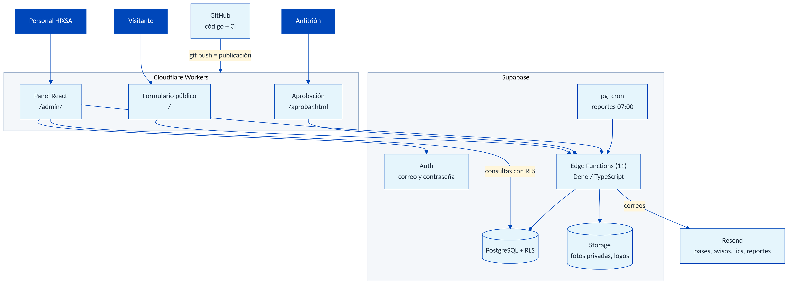
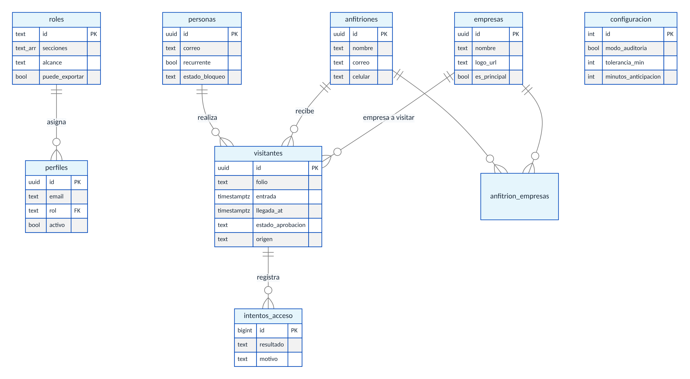
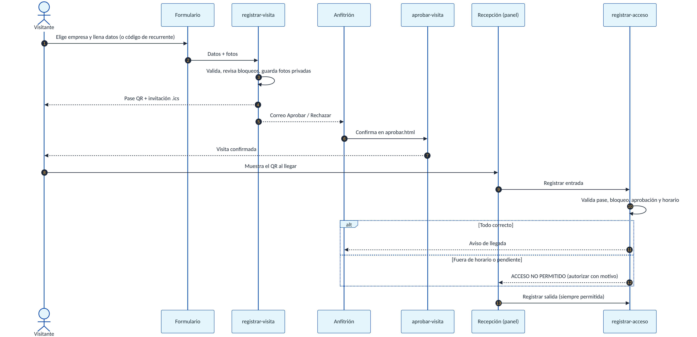

# Documentación técnica

**Registro de visitas HIXSA, versión 4.1.0**
Para desarrolladores y para Claude Code: arquitectura, datos, seguridad y cómo hacer cambios.

## 1. Visión general

Sistema web para registrar visitantes, emitir pases con QR, aprobar visitas por el anfitrión, controlar entradas y salidas en recepción, consultar, generar reportes y auditar accesos.

| Capa | Tecnología | Ubicación |
|---|---|---|
| Formulario público | HTML, CSS y JavaScript sin framework; supabase-js 2.45.4 (jsDelivr) | `public/` |
| Panel interno | React 18.3.1 + Vite 5.4; Recharts, jsQR, qrcode, jsPDF 4.2.1 | `panel/` |
| Lógica de servidor | 12 Edge Functions (Deno / TypeScript) | `supabase/functions/` |
| Base de datos | PostgreSQL con RLS | `supabase/schema.sql` + `supabase/migrations/` |
| Archivos | Supabase Storage | buckets `identificaciones`, `anfitriones`, `logos` |
| Autenticación | Supabase Auth (correo y contraseña) | tabla `perfiles` + `roles` |
| Correo | Resend API | `supabase/functions/_shared/correo.ts` |
| Tareas programadas | pg_cron + pg_net + Vault | `supabase/programar-reportes.sql` |
| Publicación | Cloudflare Workers (activos estáticos) | `wrangler.jsonc`, carpeta `dist/` |
| Verificación | GitHub Actions | `.github/workflows/ci.yml` |

No se usa ninguna API de IA en producción.

## 2. Arquitectura



- El **sitio** es estático: `npm run build` genera `dist/` (formulario en `/`, panel en `/admin/`, `aprobar.html`) y Cloudflare lo publica en cada `git push`.
- El **panel** lee la base directamente con la sesión del usuario; **RLS** decide qué filas ve.
- Todo lo que necesita privilegios, correo o reglas de negocio pasa por **Edge Functions** (con la llave de servicio).
- Los **reportes automáticos** los dispara `pg_cron`, que llama a `reporte-programado` con un secreto compartido.

## 3. Estructura del repositorio

```
public/                 Formulario, aprobar.html, estilos, logos (img/), _headers
panel/src/              Panel React
  App.jsx               Sesión, pestañas por permiso, carga bajo demanda
  components/           Recepción, FichaVisita, Tablero, Consultas (3 grupos), Reportes,
                        Configuración (usuarios, roles, empresas, anfitriones, visitantes,
                        importar y depurar, correos, bitácora), EnviarReporte, íconos
  lib/                  supabase.js, permisos.js, formato.js, pdf.js, importar.js, archivos.js
supabase/
  schema.sql            Base v3 (idempotente)
  migrations/           20261110 (fase 1), 20261111 (fase 2), 20261112 (fase 3), 20261113 (4.1.0)
  crear-admin.sql       Primer SUPERADMIN
  programar-reportes.sql  pg_cron + Vault (se ejecuta con valores reales, no se guarda)
  functions/            11 funciones + _shared/
scripts/build.mjs       Build completo (config.js + public + panel)
docs/                   Guía de instalación, esta documentación, manuales, diagramas
CLAUDE.md               Contexto para Claude Code
```

## 4. Modelo de datos



| Tabla | Propósito | Notas |
|---|---|---|
| `roles` | Roles con `secciones[]`, `alcance` (hoy, semana, sin_limite) y `puede_exportar` | `superadmin` es `sistema` (protegido) |
| `perfiles` | Usuarios del panel (1:1 con `auth.users`) | `rol` → `roles.id` |
| `empresas` | Empresas a visitar, logo, botón o lista, orden | Una sola `es_principal` (HIXSA) |
| `anfitriones` / `anfitrion_empresas` | Personas que reciben visitas y sus empresas | Formulario filtra por empresa |
| `personas` | Perfil del visitante (uno por correo) | `recurrente`, `estado_bloqueo` |
| `visitantes` | Cada visita | `folio`, horario, llegada y salida reales, aprobación, autorización, fotos, equipo, `origen` |
| `intentos_acceso` | Rechazos y autorizaciones en recepción | Base de las consultas de seguridad |
| `verificaciones` | Códigos de recurrente y tokens (hash) | Solo `service_role` |
| `configuracion` | Fila única: correos, auditoría, tolerancia, llegada temprana, calendario, logo | |
| `bitacora_cambios` / `bitacora_reportes` | Auditoría de configuración y de reportes | |

Estados de una visita (calculados en `panel/src/lib/formato.js`): *Pendiente de aprobación, Esperada, En sitio, En sitio (autorizada), Concluida, Vencido sin uso, Rechazada, Concluida (importada)*.

## 5. Seguridad

### 5.1 Permisos

- **Roles**: secciones del panel (`recepcion`, `tablero`, `consultas`, `reportes`, `config_*`), alcance de fechas y exportación.
- **Funciones SQL** (`security definer`, `search_path=''`): `tiene_permiso(seccion)`, `es_superadmin()`, `visita_en_alcance(entrada)`, `empresa_visible(empresa)`, `modo_auditoria()`.
- **RLS** en todas las tablas. `visitantes` se ve solo si el usuario está activo, la visita está en su alcance y la empresa es visible (modo auditoría).
- El panel **solo oculta** lo que el rol no puede usar; la regla real está en la base y en las funciones (`_shared/auth.ts`: `tienePermiso`, `rangoDelAlcance`, `filtroAuditoria`).

### 5.2 Datos personales

- Fotos de identificación y selfies en bucket **privado**; el panel usa enlaces firmados de 5 minutos.
- El formulario público no lee tablas: usa `rpc('config_publica')` (empresas y anfitriones sin correos).
- Códigos de recurrente (6 dígitos, 10 min, 5 intentos) y tokens de aprobación (un solo uso) se guardan **solo como SHA-256**.
- Un perfil existente solo se actualiza con verificación de código (evita suplantación).
- Borrado de perfiles: anonimiza visitas y borra fotos; excluye bloqueados y visitas próximas.

### 5.3 Secretos

| Secreto | Dónde | Uso |
|---|---|---|
| `RESEND_API_KEY`, `EMAIL_FROM` | Supabase (Edge Functions) | Envío de correos |
| `PUBLIC_SITE_URL` | Supabase | Enlaces del QR y de aprobación |
| `ALLOWED_ORIGIN` | Supabase | CORS de las funciones |
| `REPORTES_SECRETO` | Supabase + Vault | Autenticar a pg_cron |
| `SUPABASE_URL`, `SUPABASE_ANON_KEY` | Cloudflare (variables de build) | `config.js` del sitio (públicas) |

La llave `service_role` **nunca** sale de Supabase.

## 6. Edge Functions

Todas se despliegan con `--no-verify-jwt --use-api`; las que requieren usuario validan la sesión dentro.

| Función | Quién la llama | Qué hace |
|---|---|---|
| `registrar-visita` | Formulario (público) | Valida, revisa bloqueos y recurrente, guarda fotos, crea visita pendiente, envía pase y solicitud al anfitrión |
| `visitante-recurrente` | Formulario (público) | Envía y verifica el código; devuelve datos y token |
| `aprobar-visita` | aprobar.html (token) | Aprueba o rechaza; avisa al visitante; cancela calendario |
| `registrar-acceso` | Recepción | `llegada`, `autorizar`, `aprobar`, `salida`, `consultar`; valida horario; registra intentos |
| `reenviar-pase` | Consultas / Recepción | Reenvía QR e invitación |
| `gestionar-visitante` | Configuración | Bloqueos con aviso por correo |
| `admin-usuarios` | Configuración | Alta, rol, activación, contraseña temporal, eliminación |
| `enviar-reporte` | Consultas / Reportes | CSV (y PDF del panel) por correo |
| `reporte-programado` | pg_cron / SUPERADMIN | Reporte diario y semanal |
| `importar-datos` | Configuración | Importación de Glide y plantilla |
| `borrar-perfiles` | Configuración (SUPERADMIN) | Vista previa y borrado con anonimización |
| `crear-invitacion` | Consultas / Configuración | Invitación del personal: aprobada, aviso al anfitrión y QR nuevo |

Módulos compartidos en `_shared/`: `http.ts` (CORS), `supabase.ts`, `auth.ts`, `correo.ts` (plantilla con marca), `formato.ts`, `filtros.ts`, `horario.ts`, `tokens.ts`, `calendario.ts` (ICS), `pase.ts`, `fotos.ts`, `estadisticas.js`.

## 7. Flujo principal



**Reglas de horario** (`_shared/horario.ts`): la entrada se permite el día de la visita desde `entrada − minutos_anticipacion` hasta `entrada + tolerancia_min`. Antes o después, el mismo día: rechazo **autorizable** con motivo. Otro día o después de la salida: rechazo **no autorizable**. Las salidas siempre se permiten.

**Indicadores** (`_shared/estadisticas.js`): un solo módulo para el panel y los correos. Puntualidad = llegadas dentro de la tolerancia, sin autorización, excluyendo importadas.

## 8. Cómo hacer cambios

| Quiero cambiar… | Archivos | Despliegue |
|---|---|---|
| Textos, colores o diseño del formulario | `public/index.html`, `public/styles.css`, `public/app.js` | `git push` |
| Pantallas del panel | `panel/src/components/…` | `git push` |
| Reglas de validación del registro | `public/app.js` **y** `supabase/functions/registrar-visita/` | función + `git push` |
| Reglas de horario | `_shared/horario.ts` (+ prueba) | `registrar-acceso` |
| Contenido de correos | `_shared/correo.ts`, `_shared/pase.ts`, función | funciones afectadas |
| Tablas o permisos | **migración nueva** en `supabase/migrations/` | SQL Editor |
| Indicadores | `_shared/estadisticas.js` (+ prueba) | `reporte-programado` + `git push` |

**Agregar un campo al registro** (lista de verificación):
1. Migración: columna + restricción.
2. `public/index.html` y `public/app.js` (campo, validación y envío).
3. `registrar-visita` (validación e inserción).
4. Panel: `CAMPOS_VISITA` en `lib/supabase.js`, ficha, CSV en `lib/formato.js`.
5. Importación (`lib/importar.js`, `importar-datos`) si aplica.

**Con Claude Code:** abre la carpeta, deja que lea `CLAUDE.md` y pide cambios concretos, por ejemplo:
> *Agrega el campo “placas del vehículo” (opcional, 10 caracteres) al registro, en la ficha de recepción y en el CSV. Crea la migración nueva y dime qué funciones desplegar.*

El MCP de Supabase está en **solo lectura** (`.mcp.json`): Claude puede consultar, pero los cambios de base se hacen con migraciones revisadas.

## 9. Verificación

`git push` ejecuta el CI: sintaxis de JavaScript, `deno check` de las 11 funciones, pruebas de horario (7 casos) y de indicadores y calendario (15 casos), y build completo. En local:

```powershell
npm run build
cd supabase/functions/_shared; deno run horario.test.ts; deno run estadisticas.test.ts
```

## 10. Operación

| Qué revisar | Dónde |
|---|---|
| Errores de una función | Supabase → Edge Functions → *función* → Logs |
| Ejecución de reportes | `select * from cron.job_run_details order by start_time desc limit 10;` |
| Pases no enviados | Consultas: columna *Pase* = *Error de envío* (`visitantes.correo_error`) |
| Cambios de configuración | Configuración → Bitácora |

## 11. Dependencias y mantenimiento

- `npm audit --omit=dev`: **0 vulnerabilidades** (jsPDF 4.2.1, jspdf-autotable 5.0.9, DOMPurify 3.4.17 fijado con `overrides`).
- Vite 5.4 tiene avisos que solo afectan a su **servidor de desarrollo**, que este proyecto no usa (`npm run dev` sirve `dist/` ya compilado). Migrar a Vite 8 es un cambio mayor sin beneficio de seguridad aquí.
- **No** usar `npm audit fix --force`: cambia versiones mayores sin probar.
- El panel se divide en partes: la librería de PDF (~790 KB) y las gráficas solo se descargan al usarse.

## 12. Limitaciones y siguientes pasos

- **Dominio en Resend**: sin dominio verificado, los correos solo llegan a la cuenta de Resend.
- **Inicio de sesión con Google Workspace**: pospuesto (requiere credenciales en Google Cloud).
- **Avisos por WhatsApp**: el celular del anfitrión ya se guarda para integrarlo.
- **Retención de datos**: el borrado es manual (Configuración → Importar y depurar); puede programarse.
