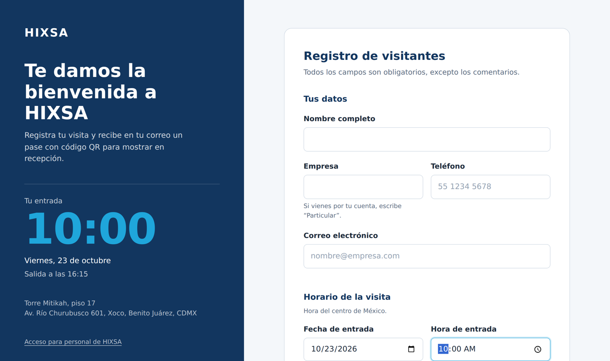
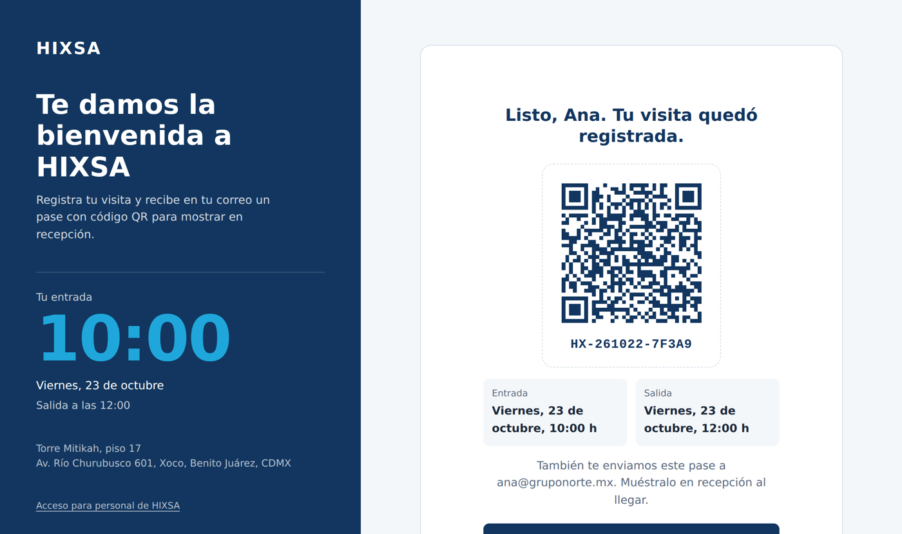
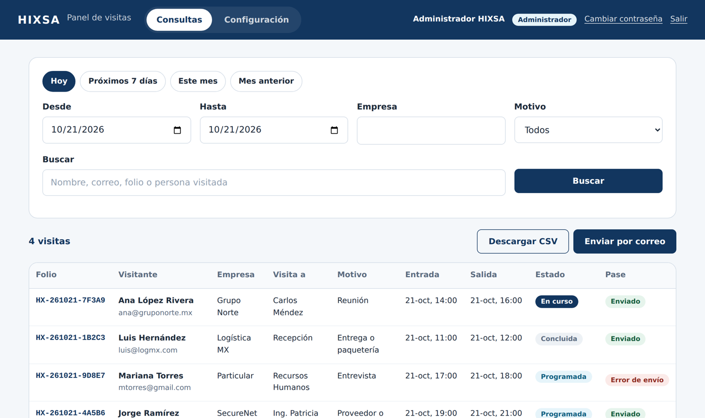
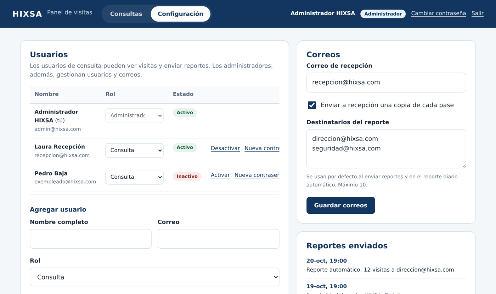
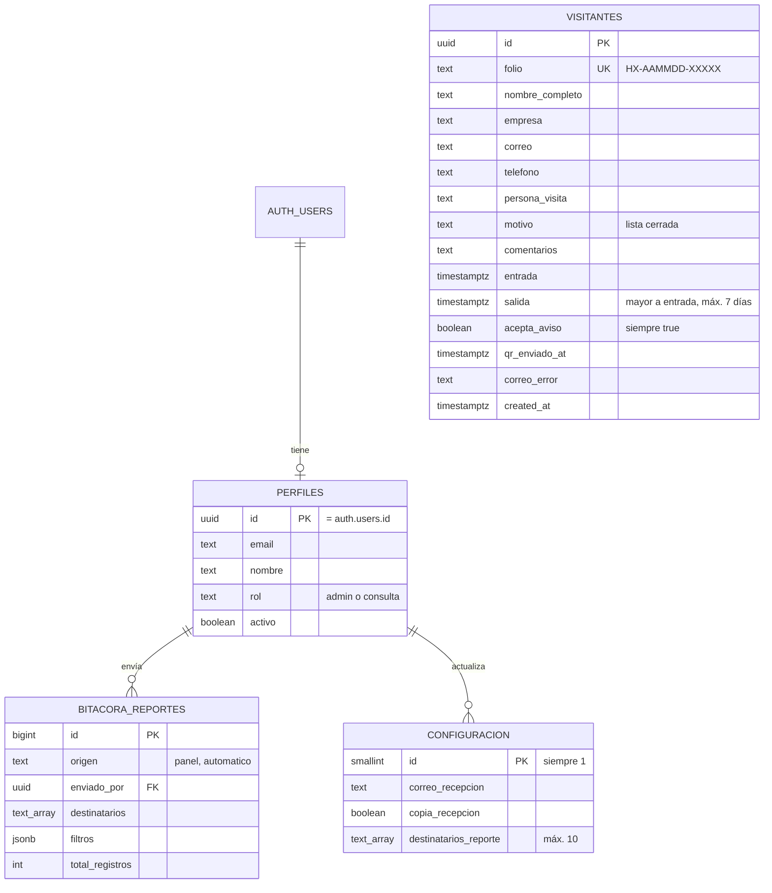
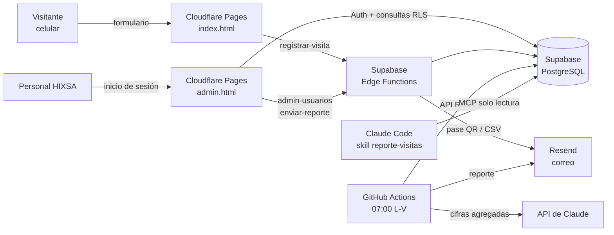
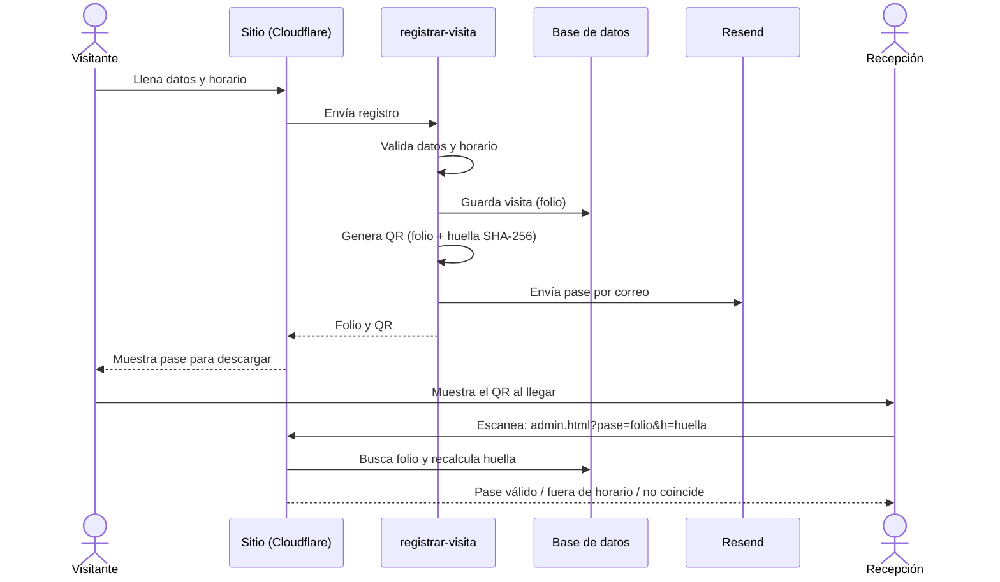

# Entregables: Curso Vibe Coding con Claude Code

**Proyecto integrador:** Registro de visitas HIXSA
**Área beneficiada:** Recepción y Seguridad (con reportes para Dirección)
**Versión:** 2.0.0, octubre 2026

| Entregable | Dónde está | Estado |
|---|---|---|
| 1. Repositorio con historial de cambios | GitHub, rama `main` | Listo |
| 2. App conectada a datos reales por MCP + skill | `.mcp.json`, `.claude/skills/reporte-visitas/` | Listo |
| 3. Script que usa la API sin intervención manual | `scripts/reporte-diario.mjs`, `.github/workflows/reporte-diario.yml` | Listo |
| 4. Proyecto integrador de punta a punta | Todo el repositorio; este documento | Listo |
| Demo, repositorio documentado y presentación de 15 min | Sitio en Cloudflare Pages, `README.md`, `docs/Presentacion_Direccion_Registro_Visitas.pptx` | Listo |

### Evidencia visual

| Formulario con horario | Pase con QR |
|---|---|
|  |  |
| **Panel: Consultas** | **Panel: Configuración** |
|  |  |

Validación del pase en celular: `img/captura-validacion.png`. Diagramas en PNG: `img/modelo-datos.png`, `img/arquitectura.png`, `img/flujo-visitante.png`.

---

## Entregable 1. Repositorio con historial de cambios

### Qué se entrega

Un repositorio Git publicado en GitHub cuyo historial muestra la evolución del proyecto, un cambio lógico por commit, con mensajes descriptivos en español y prefijos convencionales (`feat:`, `fix:`, `docs:`).

### Historial

| # | Tipo | Cambio |
|---|---|---|
| 1 | Funcionalidad | Formulario público de registro de visitantes (v1) |
| 2 | Funcionalidad (db) | Modelo v2 con horario, folio, perfiles, configuración y bitácora |
| 3 | Funcionalidad (api) | Edge Functions para registro con QR, usuarios y reportes |
| 4 | Funcionalidad (web) | Horario de entrada y salida, y pase con QR en pantalla |
| 5 | Funcionalidad (panel) | Panel interno con autenticación, consultas, reportes y configuración |
| 6 | Funcionalidad (automatización) | Reporte diario con API de Supabase y API de Claude |
| 7 | Funcionalidad (mcp) | Conexión MCP a Supabase y skill de reporte semanal |
| 8 | Corrección (automatización) | Compatibilidad con llaves secretas nuevas de Supabase (sb_secret_) |
| 9 | Documentación | Guía de instalación v2, entregables del curso y changelog |
| 10 | Documentación | Tabla del historial de cambios en ENTREGABLES |
| 11 | Documentación | Diagramas y capturas como evidencia; plurales en el reporte de respaldo |
| 12 | Documentación | Presentación para Dirección e historial completo |

Cada commit incluye un cuerpo con el detalle de los cambios (`git show <commit>`).

### Buenas prácticas aplicadas

- **Secretos fuera del repositorio:** `.gitignore` excluye `.env` y `public/config.js`; las llaves viven en Cloudflare, Supabase y GitHub Secrets.
- **Verificación automática (CI):** `.github/workflows/ci.yml` revisa en cada push la sintaxis del frontend y los scripts, el build, el reporte en modo demo y los tipos de las Edge Functions.
- **Contexto para la IA:** `CLAUDE.md` documenta arquitectura, reglas de seguridad y convenciones, para que cualquier sesión de Claude Code respete las mismas reglas.
- **Documentación:** `README.md` (instalación), `docs/ENTREGABLES.md` (este documento), `CHANGELOG.md` (versiones).

### Cómo verificarlo

```bash
git log --oneline --graph
```

En GitHub: pestaña **Commits** para el historial y pestaña **Actions** para ver la verificación en verde.

---

## Entregable 2. Conexión a datos reales por MCP y skill

### Qué se entrega

1. **Conexión MCP:** `.mcp.json` registra el servidor MCP oficial de Supabase para que Claude Code consulte la base de datos real de visitas.
2. **Skill:** `.claude/skills/reporte-visitas/` automatiza una tarea repetitiva del equipo: el **reporte semanal de visitas** que Recepción prepara cada lunes para Dirección.

### Configuración MCP

```json
{
  "mcpServers": {
    "supabase": {
      "type": "http",
      "url": "https://mcp.supabase.com/mcp?project_ref=${SUPABASE_PROJECT_REF}&read_only=true"
    }
  }
}
```

Decisiones de diseño:

- **Solo lectura** (`read_only=true`): la IA puede consultar, pero no modificar ni borrar datos.
- **Sin secretos en el archivo:** el proyecto se toma de la variable `SUPABASE_PROJECT_REF` y la autenticación se hace con OAuth en `/mcp`, así que `.mcp.json` se puede compartir en GitHub.
- **Alcance de proyecto:** todo el equipo que clone el repositorio obtiene la misma conexión.

### La skill `reporte-visitas`

| Archivo | Contenido |
|---|---|
| `SKILL.md` | Cuándo usarla, pasos, reglas de privacidad y criterios de alerta |
| `consultas.sql` | 8 consultas de solo lectura, probadas contra la base de datos |
| `plantilla.md` | Estructura fija del reporte para que todas las semanas se vea igual |

Flujo: el usuario pide *“Genera el reporte semanal de visitas”* → Claude Code reconoce la skill → calcula la semana anterior en hora de CDMX → ejecuta las consultas por MCP → llena la plantilla → guarda `reportes/semana-AAAA-MM-DD.md` y muestra el resumen y las alertas.

**Antes:** contar visitas en una libreta u hoja de cálculo y redactar el resumen a mano.
**Después:** un mensaje a Claude Code, con datos reales y formato constante.

### Cómo verificarlo

1. `export SUPABASE_PROJECT_REF=xxxx` y abrir `claude` en la carpeta del proyecto.
2. `/mcp` debe mostrar `supabase` conectado.
3. Pedir: *“Genera el reporte semanal de visitas”* o *“¿Qué empresas nos visitaron más este mes?”*.
4. Evidencia para la entrega: captura de `/mcp` conectado y del reporte generado.

---

## Entregable 3. Script que usa la API sin intervención manual

### Qué se entrega

`scripts/reporte-diario.mjs`, ejecutado por GitHub Actions de **lunes a viernes a las 07:00** (hora de CDMX), procesa los datos del área de **Recepción y Seguridad**:

1. **API REST de Supabase:** lee las visitas del día anterior y la agenda del día.
2. **Procesamiento:** calcula indicadores (total, empresas, motivos, hora pico, duración promedio, visitas de más de 8 horas, pases no enviados, entregas programadas).
3. **API de Claude:** genera un resumen ejecutivo, hasta 3 alertas y una recomendación del día, en JSON.
4. **API de Resend:** envía el reporte HTML a los destinatarios configurados en el panel.
5. **Bitácora:** registra el envío en `bitacora_reportes` (visible en el panel).

### Decisiones de diseño

- **Privacidad:** a la API de Claude solo se envían cifras agregadas. Nombres, correos y teléfonos nunca salen hacia la IA; la agenda con nombres se arma localmente.
- **Tolerancia a fallas:** si la API de Claude no responde, el script genera un resumen básico y el reporte se envía igual.
- **Modelo configurable:** variable `CLAUDE_MODEL` (por defecto `claude-haiku-5-5`, rápido y económico para esta tarea).
- **Modos de prueba:** `--dry-run` genera la vista previa sin enviar; `--demo` usa datos de ejemplo sin conectarse a Supabase.

### Programación

```yaml
on:
  schedule:
    - cron: "0 13 * * 1-5" # 13:00 UTC = 07:00 en Ciudad de México
  workflow_dispatch:       # también se puede lanzar a mano
```

### Cómo verificarlo

```bash
npm run reporte:demo
```

En GitHub: **Actions → Reporte diario de visitas → Run workflow**. Evidencia: ejecución en verde y el correo recibido.

---

## Entregable 4. Proyecto integrador de punta a punta

### 4.1 Requerimiento

**Problema.** El registro de visitantes en recepción es manual: no hay aviso previo de quién llega, no se puede comprobar que una visita estaba programada, la información no se puede consultar ni reportar, y los datos personales no tienen un aviso de privacidad aceptado de forma explícita.

**Objetivo.** Que cada visita quede registrada antes de llegar, con un pase verificable, y que Recepción, Seguridad y Dirección tengan información confiable sin trabajo manual.

**Usuarios y necesidades**

| Usuario | Necesita |
|---|---|
| Visitante | Registrarse rápido desde su celular, elegir horario y recibir un pase |
| Recepción | Validar el pase al llegar y saber quién viene hoy |
| Personal de consulta | Buscar visitas, exportarlas y enviarlas por correo |
| Administrador | Dar de alta usuarios y definir quién recibe reportes |
| Dirección | Un resumen diario y semanal sin pedirlo |

**Requerimientos funcionales**

1. Formulario público con nombre, empresa, teléfono, **correo obligatorio**, persona que visita, motivo, comentarios, **fecha y hora de entrada y salida**, y aceptación del [aviso de privacidad](https://www.hixsa.com/sobre-nosotros/aviso-de-privacidad/).
2. Envío por correo de un **código QR generado a partir de los datos y el horario registrados**.
3. Panel con **autenticación**: pestaña de **Consultas** (filtros, CSV, reporte por correo) y pestaña de **Configuración** (usuarios y correos).
4. Un **usuario administrador** inicial que da de alta a los usuarios de consulta.
5. Validación del pase al escanear el QR.
6. Reporte diario automático y reporte semanal bajo demanda.

**Requerimientos no funcionales**

- Diseño responsivo con la identidad de HIXSA; funciona en celular.
- Seguridad: RLS en todas las tablas, mínimo privilegio, llaves secretas solo en servidor.
- Accesible: etiquetas, foco visible, mensajes de error por campo, movimiento reducido.
- Costo de operación bajo: servicios con plan gratuito para el piloto.

### 4.2 Modelo de datos



**Permisos por rol (RLS)**

| Tabla | Público (anon) | Consulta | Administrador | Edge Functions |
|---|---|---|---|---|
| `visitantes` | Sin acceso | Leer | Leer | Insertar y actualizar estado del correo |
| `perfiles` | Sin acceso | Su propio perfil | Leer todos | Crear y modificar |
| `configuracion` | Sin acceso | Leer | Leer y modificar | Leer |
| `bitacora_reportes` | Sin acceso | Sin acceso | Leer | Insertar |

Todas las reglas se probaron en PostgreSQL con cada rol: el público no puede leer ni escribir, un usuario inactivo no ve nada, un usuario de consulta no puede modificar la configuración ni los perfiles, y nadie puede borrar visitas.

### 4.3 Arquitectura



**Flujo del visitante**



**Por qué el QR es verificable.** El QR contiene una liga al panel con el folio y una huella de 12 caracteres calculada con SHA-256 sobre folio, correo, entrada y salida. Al escanearlo, el panel (con sesión iniciada) busca el folio y recalcula la huella: si alguien altera el horario o el pase pertenece a otro registro, la huella no coincide. El QR no expone datos personales.

### 4.4 Código con Claude Code

El proyecto se construyó por iteraciones con Claude Code, una funcionalidad por sesión, revisando y probando cada paso antes del commit:

| Iteración | Instrucción a Claude Code (resumen) | Resultado |
|---|---|---|
| 1 | Formulario de visitantes con la paleta de HIXSA, Supabase y despliegue en Cloudflare | v1: formulario, tabla con RLS, guía |
| 2 | Agregar horario de entrada y salida, y pase QR por correo | Modelo v2, Edge Function `registrar-visita` |
| 3 | Panel con autenticación, consultas, reportes y configuración con usuario admin | `admin.html`, `admin-usuarios`, `enviar-reporte` |
| 4 | Script diario con la API de Claude para el área de Recepción | `reporte-diario.mjs` + GitHub Actions |
| 5 | Conectar Supabase por MCP y crear skill de reporte semanal | `.mcp.json` + skill |
| 6 | Documentación de entregables y presentación | `docs/`, PPT |

Prácticas que hicieron confiable el resultado:

- **`CLAUDE.md` como memoria del proyecto:** reglas de seguridad y convenciones que Claude Code respeta en cada sesión.
- **Pruebas antes de cada commit:** SQL probado en PostgreSQL (instalación nueva, migración desde v1, idempotencia y permisos por rol); Edge Functions validadas con `deno check`; generación y lectura real del QR; formulario y panel probados en navegador (escritorio y celular).
- **Revisión humana:** cada cambio se revisó antes de aceptarlo; se corrigieron problemas detectados en las pruebas (por ejemplo, elementos ocultos que seguían visibles y botones que se encimaban en móvil).

### 4.5 Integración

| Servicio | Integración | Credencial |
|---|---|---|
| Supabase Database | supabase-js en el navegador (con RLS) y REST en el script | Llave pública / secreta |
| Supabase Auth | Inicio de sesión del panel; alta de usuarios con la Admin API | Sesión del usuario |
| Supabase Edge Functions | Lógica de servidor: registro, QR, usuarios, reportes | `service_role` interno |
| Resend | Pase QR (imagen en línea + adjunto) y reportes | `RESEND_API_KEY` |
| API de Claude | Resumen ejecutivo del reporte diario | `ANTHROPIC_API_KEY` |
| MCP de Supabase | Consultas de Claude Code a la base real | OAuth |
| GitHub Actions | CI y ejecución programada | GitHub Secrets |

### 4.6 Despliegue

| Componente | Dónde | Cómo se actualiza |
|---|---|---|
| Sitio y panel | Cloudflare Pages | Automático con cada `git push` a `main` |
| Edge Functions | Supabase | `npx supabase functions deploy` |
| Base de datos | Supabase | `schema.sql` (idempotente) |
| Reporte diario | GitHub Actions | Automático, programado |

Pasos detallados en `README.md`, Partes 1 a 8.

### 4.7 Limitaciones y siguientes pasos

- **Dominio de correo:** para enviar pases a cualquier visitante hay que verificar `hixsa.com` (o un subdominio) en Resend.
- **Registro de salida real:** hoy se guarda la salida programada; un siguiente paso es marcar la salida real al escanear el QR de nuevo.
- **Escaneo en recepción:** se usa la cámara del celular; podría agregarse un lector dentro del panel.
- **Retención de datos:** definir con el área legal cuánto tiempo se conservan los registros y programar su depuración.

---

## Demo en vivo (5 minutos dentro de la presentación)

1. **Visitante (celular):** abrir el sitio, registrar una visita para dentro de una hora, mostrar el pase en pantalla y el correo recibido.
2. **Recepción:** escanear el QR con otro celular → iniciar sesión → “Pase válido”.
3. **Consultas:** filtrar “Hoy”, mostrar la visita, descargar CSV y enviar el reporte por correo.
4. **Configuración:** dar de alta un usuario de consulta y mostrar la contraseña temporal.
5. **Automatización:** mostrar en GitHub Actions la ejecución del reporte diario y el correo con el resumen de Claude.
6. **Claude Code:** `/mcp` conectado y *“Genera el reporte semanal de visitas”*.

> Plan B si falla la red: capturas de pantalla en la presentación y `npm run reporte:demo` en local.

## Lista de entrega

- [ ] URL del repositorio de GitHub (con historial y Actions en verde)
- [ ] URL pública del sitio en Cloudflare Pages
- [ ] Usuario de consulta de prueba para quien evalúe
- [ ] Capturas: pase recibido, panel, `/mcp` conectado, workflow en verde
- [ ] `docs/Presentacion_Direccion_Registro_Visitas.pptx` (13 diapositivas con notas del orador)
