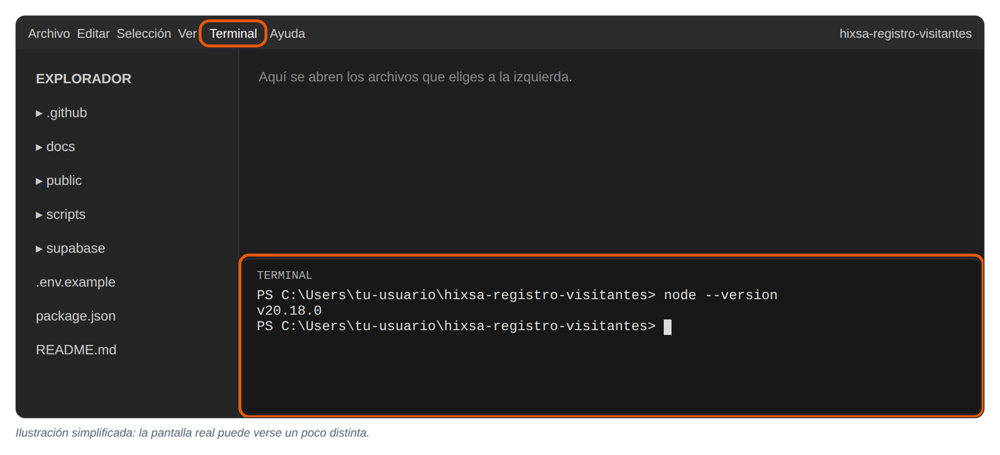
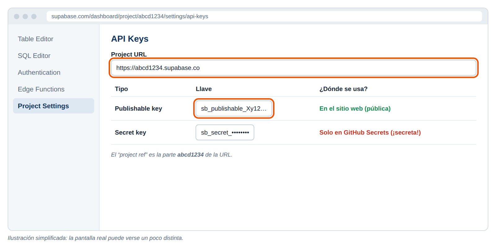
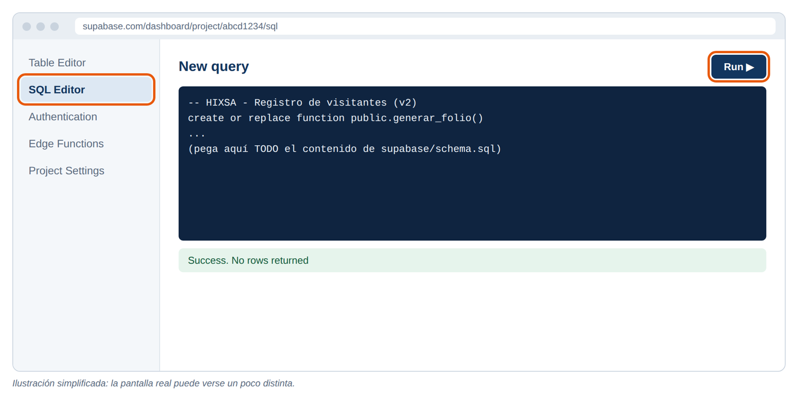
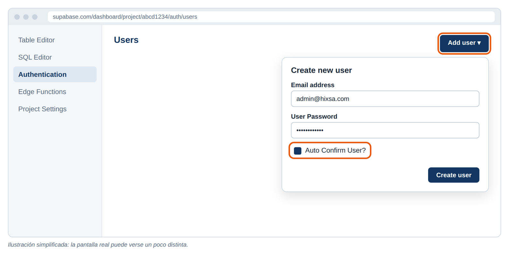
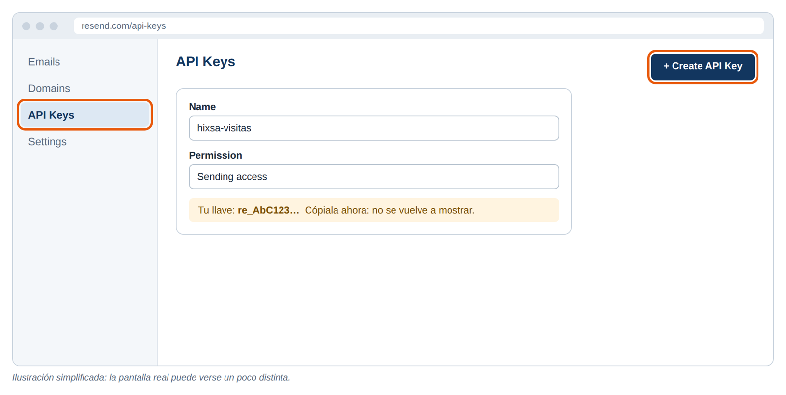
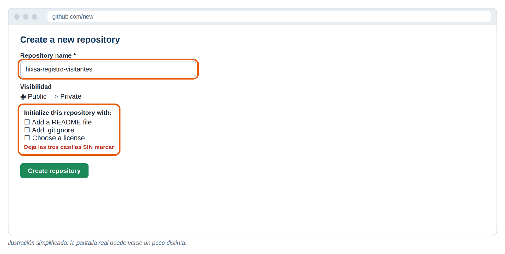

# Guía de instalación desde cero

**Registro de visitas HIXSA, versión 4.1.0**
Paso a paso para montar el sistema en cuentas nuevas de Supabase, Resend, GitHub y Cloudflare. No necesitas saber programar: copia y pega los comandos.

## 0. Antes de empezar

### Cuentas (todas tienen plan gratuito suficiente para empezar)

| Servicio | Para qué | Dirección |
|---|---|---|
| **Supabase** | Base de datos, fotos, usuarios y funciones | supabase.com |
| **Resend** | Envío de correos | resend.com |
| **GitHub** | Guardar el código | github.com |
| **Cloudflare** | Publicar el sitio | dash.cloudflare.com |

### Hoja de datos

Anota cada valor conforme lo obtengas. **Las marcadas como secretas no se comparten ni se guardan en archivos del proyecto.**

| Dato | Ejemplo | ¿Secreto? |
|---|---|---|
| Project ref de Supabase | `ziqfcmgufkeydulgtnvl` | No |
| SUPABASE_URL | `https://ziqfcmgufkeydulgtnvl.supabase.co` | No |
| Publishable key (anon) | `sb_publishable_…` | No |
| Secret key (service role) | `sb_secret_…` | **Sí** |
| RESEND_API_KEY | `re_…` | **Sí** |
| Remitente (EMAIL_FROM) | `HIXSA Recepción <recepcion@visitas.hixsa.com>` | No |
| Dirección del sitio | `https://hixsa-registro-visitantes.<cuenta>.workers.dev` | No |
| REPORTES_SECRETO | 40 caracteres aleatorios | **Sí** |
| Correo del primer SUPERADMIN | `mario.rivera@hixsa.com` | No |

## 1. Herramientas en tu computadora

1. Instala **Git** (git-scm.com), **Node.js LTS** (nodejs.org) y **Visual Studio Code** (code.visualstudio.com).
2. Abre VS Code → **Terminal → New Terminal** (PowerShell en Windows).
3. Comprueba: `git --version` y `node --version` (debe ser 20 o mayor).
4. Descarga el proyecto: copia la carpeta del repositorio o, desde GitHub, `git clone <url-del-repositorio>`. Ábrela con **File → Open Folder** y en la terminal ejecuta:

```powershell
npm install
```



## 2. Supabase: base de datos

1. **New project**: nombre `hixsa-visitantes`, región cercana (por ejemplo *East US*), contraseña de base de datos segura (guárdala).
2. Cuando termine, ve a **Project Settings → API Keys** y anota la **URL**, la **publishable key** y la **secret key**.



3. **SQL Editor → New query**. Ejecuta **en este orden**, pegando cada archivo completo y presionando **Run**:
   1. `supabase/schema.sql`
   2. `supabase/migrations/20261110_v4_fase1.sql`
   3. `supabase/migrations/20261111_v4_fase2.sql`
   4. `supabase/migrations/20261112_v4_fase3.sql`
   5. `supabase/migrations/20261113_v4_1_0.sql`



4. **Primer SUPERADMIN**: en **Authentication → Users → Add user → Create new user**, escribe el correo y una contraseña, y marca **Auto Confirm User**.



5. Abre `supabase/crear-admin.sql`, cambia el correo si usaste otro, pégalo en el SQL Editor y ejecútalo. **Qué deberías ver:** una fila con `rol = superadmin`.

## 3. Resend: correos

1. Crea la cuenta y una **API key** con permiso *Sending access*. Anótala (solo se muestra una vez).



2. **Recomendado:** verifica un dominio. En **Domains → Add Domain** escribe `visitas.hixsa.com` y pide a quien administra el DNS que agregue los registros que muestra Resend. Al quedar *Verified*, tu remitente será `HIXSA Recepción <recepcion@visitas.hixsa.com>`.

> **Sin dominio verificado**, usa `HIXSA Recepción <onboarding@resend.dev>`: los correos **solo llegan al correo de tu cuenta de Resend**, y si un mensaje lleva cualquier otro destinatario (incluida una copia), se rechaza completo.

## 4. Funciones del servidor

En la terminal de VS Code, dentro del proyecto:

```powershell
npx supabase login
npx supabase link --project-ref TU_PROJECT_REF
```

Guarda los secretos (cambia los valores; la dirección del sitio la completas en el paso 6, por ahora usa `*`):

```powershell
npx supabase secrets set RESEND_API_KEY=re_tu_llave
npx supabase secrets set "EMAIL_FROM=HIXSA Recepción <onboarding@resend.dev>"
npx supabase secrets set "ALLOWED_ORIGIN=*"
npx supabase secrets set PUBLIC_SITE_URL=https://pendiente.example
```

Despliega las 12 funciones:

```powershell
$f = "registrar-visita","registrar-acceso","admin-usuarios","enviar-reporte","visitante-recurrente","aprobar-visita","gestionar-visitante","reenviar-pase","reporte-programado","importar-datos","borrar-perfiles","crear-invitacion"
$f | ForEach-Object { npx supabase functions deploy $_ --no-verify-jwt --use-api }
```

**Qué deberías ver:** `Deployed Functions on project …` doce veces.

## 5. GitHub

1. **New repository**: nombre `hixsa-registro-visitantes`, **Private**, sin README.



2. En la terminal:

```powershell
git init
git add -A
git commit -m "Registro de visitas HIXSA v4"
git branch -M main
git remote add origin https://github.com/TU_USUARIO/hixsa-registro-visitantes.git
git push -u origin main
```

> Antes del primer `git add`, revisa que **no exista** un archivo `.env` con llaves. El `.gitignore` ya excluye `.env`, `*.csv` e `importaciones/`.

## 6. Cloudflare Workers: publicar el sitio

1. **Workers & Pages → Create → Import a repository** → conecta GitHub y elige el repositorio.
2. Configuración del proyecto:

| Campo | Valor |
|---|---|
| Project name | `hixsa-registro-visitantes` (igual que `name` en `wrangler.jsonc`) |
| Build command | `npm run build` |
| Deploy command | `npx wrangler deploy` |
| Variables de build | `SUPABASE_URL` = tu URL · `SUPABASE_ANON_KEY` = tu publishable key · `NODE_VERSION` = `20` |

3. **Deploy**. Al terminar, copia la dirección `https://…workers.dev`.
4. Regresa a la terminal y completa los secretos con esa dirección:

```powershell
npx supabase secrets set PUBLIC_SITE_URL=https://tu-sitio.workers.dev
npx supabase secrets set ALLOWED_ORIGIN=https://tu-sitio.workers.dev
```

Desde ahora, **cada `git push` publica el sitio** automáticamente.

## 7. Reportes automáticos

1. Genera el secreto y guárdalo en las funciones:

```powershell
$s = -join ((48..57) + (97..122) | Get-Random -Count 40 | ForEach-Object {[char]$_})
npx supabase secrets set REPORTES_SECRETO=$s
$s | Set-Clipboard
```

2. En el **SQL Editor**, pega el **contenido** de `supabase/programar-reportes.sql` y en la consulta (no en el archivo) reemplaza `TU_PROJECT_REF` y `PEGA_AQUI_EL_SECRETO` (con **Ctrl + V**). **Run**.
3. **Qué deberías ver:** `hixsa-reporte-diario` y `hixsa-reporte-semanal` con `active = true`.

> Si marca error con `pg_cron` o `pg_net`, actívalas en **Database → Extensions** y repite. **Nunca guardes** el archivo con el secreto real.

## 8. Primer ingreso y configuración

Entra a `https://tu-sitio.workers.dev/admin/` con el SUPERADMIN y configura, en este orden:

1. **Configuración → Empresas**: logos de cada empresa, cuáles como botón y cuáles en lista; logo del sistema.
2. **Configuración → Anfitriones**: nombre, área, **correo**, celular y empresas a las que pertenece.
3. **Configuración → Usuarios**: alta del personal con su rol; comparte la contraseña temporal por un canal seguro.
4. **Configuración → Roles**: ajusta secciones, fechas y exportación si hace falta.
5. **Configuración → Correos y avisos**: correo de recepción, destinatarios de reportes, **correos para Google Calendar**, llegada temprana (10) y tolerancia (15). Usa **Enviar reporte diario de prueba**.
6. Opcional: **Importar y depurar** para traer datos de Glide (primero `visitantes.csv`, luego `Visitas.csv`).

## 9. Prueba final

- [ ] La bienvenida muestra las empresas con sus logos.
- [ ] Un registro de prueba recibe el pase con QR y la invitación de calendario.
- [ ] El anfitrión recibe *Aprobar / Rechazar* y al aprobar, el visitante recibe la confirmación.
- [ ] En Recepción, el QR abre la ficha y **Registrar entrada** avisa al anfitrión.
- [ ] Fuera del horario aparece **ACCESO NO PERMITIDO** y se puede autorizar con motivo.
- [ ] Consultas y Reportes muestran la visita; el PDF se descarga.
- [ ] El modo auditoría deja solo HIXSA en la bienvenida y en el panel.
- [ ] Al día siguiente hábil a las 07:00 llega el reporte diario.

## 10. Opcional: Claude Code y MCP de Supabase

`.mcp.json` conecta Claude Code a Supabase **en solo lectura**. Cambia `project_ref` por el tuyo. En Claude Code, `/mcp` debe mostrar *supabase · connected*. `CLAUDE.md` le da a Claude el contexto del proyecto.

## 11. Problemas comunes

| Mensaje o síntoma | Causa | Solución |
|---|---|---|
| `Entrypoint path does not exist` al desplegar | La terminal no está en la carpeta del proyecto | `cd` a la carpeta que contiene `package.json` |
| `blocked by CORS policy` | `ALLOWED_ORIGIN` no coincide con la dirección del sitio | Secreto `ALLOWED_ORIGIN` igual a la URL exacta (o `*` para pruebas) |
| `403 … domain is not verified` | Remitente con un dominio no verificado | Verifica el dominio o usa `onboarding@resend.dev` |
| `You can only send testing emails to your own email address` | Resend sin dominio: solo entrega a tu cuenta | Verifica el dominio; mientras tanto usa ese correo (también en copias) |
| `Invalid API key` / `JWT issued at future` | Llave equivocada o tipo JWT | Usa las llaves nuevas `sb_publishable_` / `sb_secret_` |
| `column … does not exist` | Falta ejecutar una migración | Ejecuta las migraciones en orden |
| No aparecen anfitriones en el formulario | Anfitrión sin la empresa elegida | Configuración → Anfitriones → empresas a las que pertenece |
| Cloudflare: *Faltan variables* o el sitio no conecta | Variables de build vacías | `SUPABASE_URL` y `SUPABASE_ANON_KEY` en el proyecto de Cloudflare y *Retry deployment* |
| Cloudflare: error de Vite al publicar | Falta `wrangler.jsonc` | Debe existir con `"assets": { "directory": "./dist" }` |
| `rejected … non-fast-forward` al hacer push | GitHub tiene commits que tu carpeta no | `git pull --rebase origin main`, resuelve conflictos, `git push` (nunca `--force` sin revisar) |
| `ERR_MODULE_NOT_FOUND` | Faltan dependencias | `npm install` |
| `/mcp` falla con HTTP 400 | `project_ref` vacío en `.mcp.json` | Escribe el project ref |
| `npm audit` muestra avisos de Vite | Solo afectan su servidor de desarrollo, no usado aquí | No ejecutes `npm audit fix --force` |

## Glosario

| Término | Significado |
|---|---|
| **Edge Function** | Programa que corre en Supabase y hace tareas con permisos (correos, validaciones) |
| **RLS** | Reglas de la base que deciden qué filas ve cada usuario |
| **Migración** | Archivo SQL que actualiza la base de datos a una versión nueva |
| **Secreto** | Valor privado guardado en Supabase, nunca en el código |
| **Build** | Proceso que prepara el sitio en la carpeta `dist/` para publicarlo |
| **Modo auditoría** | Configuración que muestra solo la empresa principal en todo el sistema |
