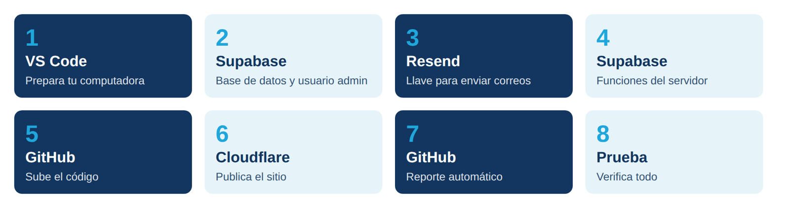
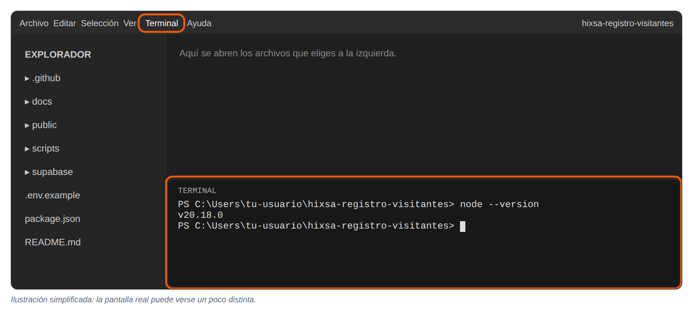
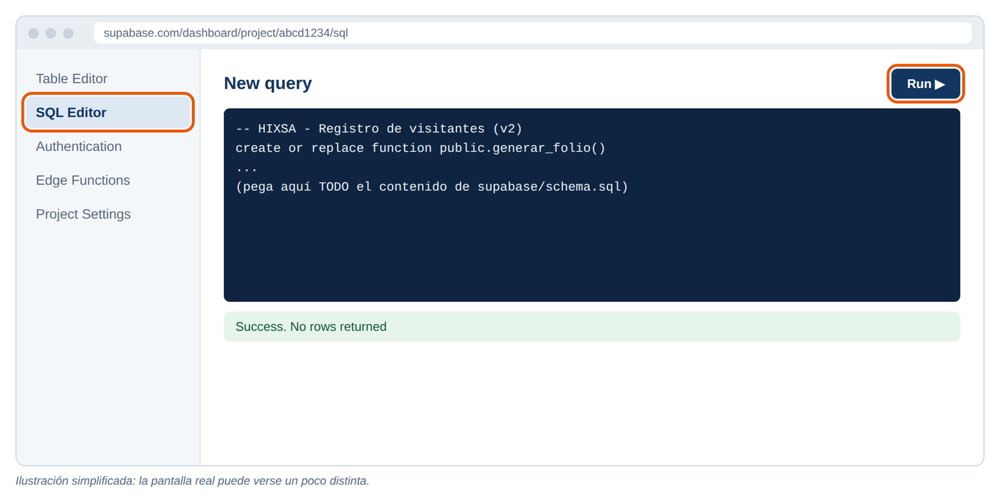
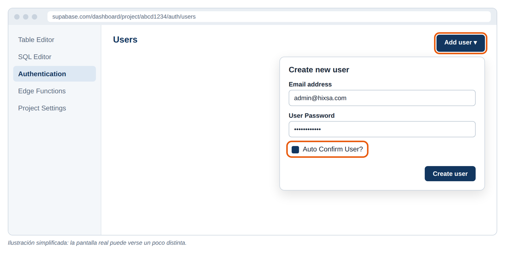
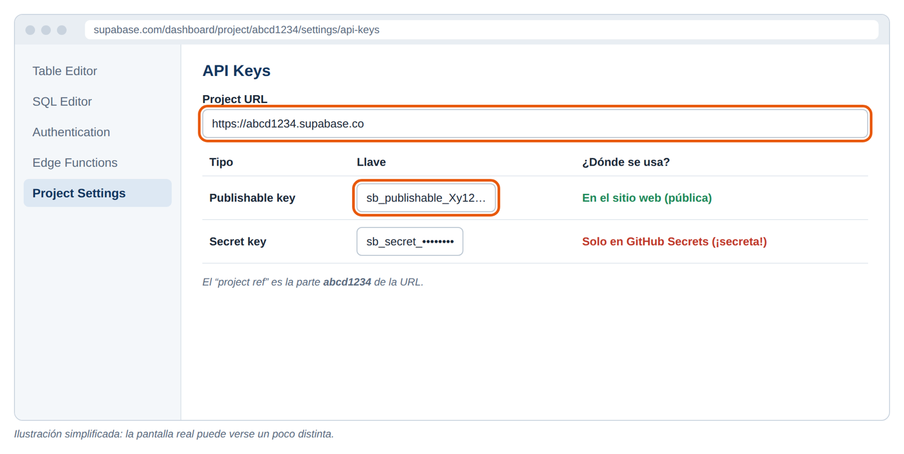
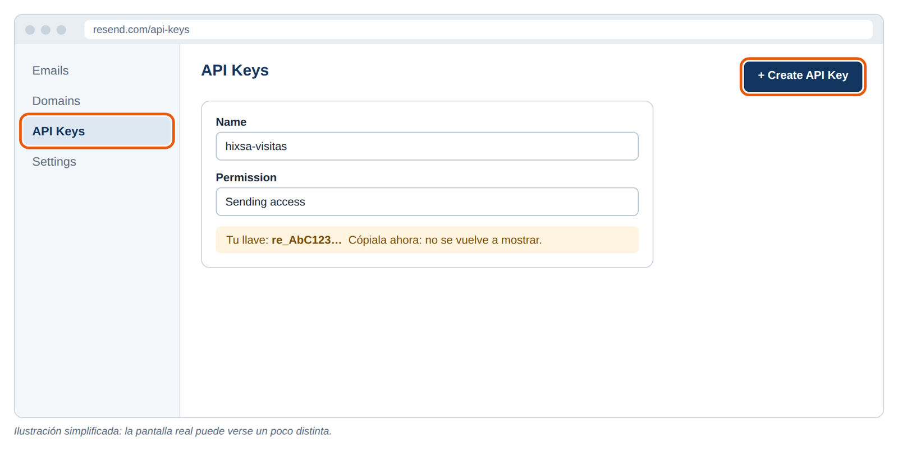
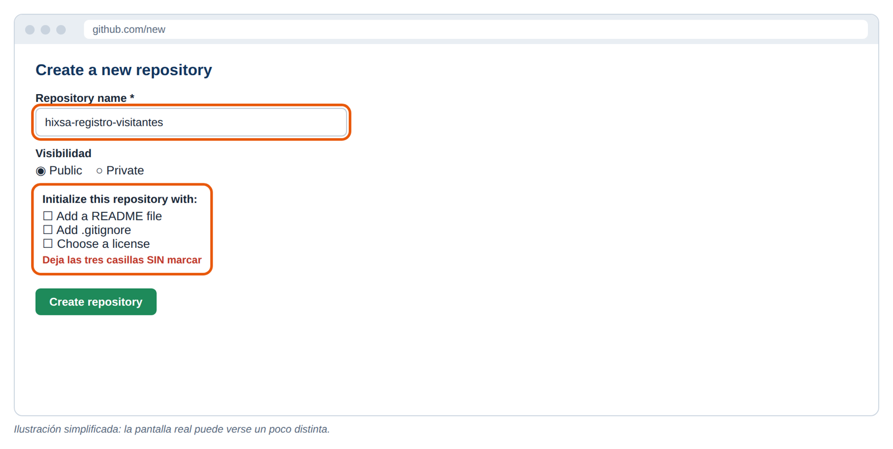
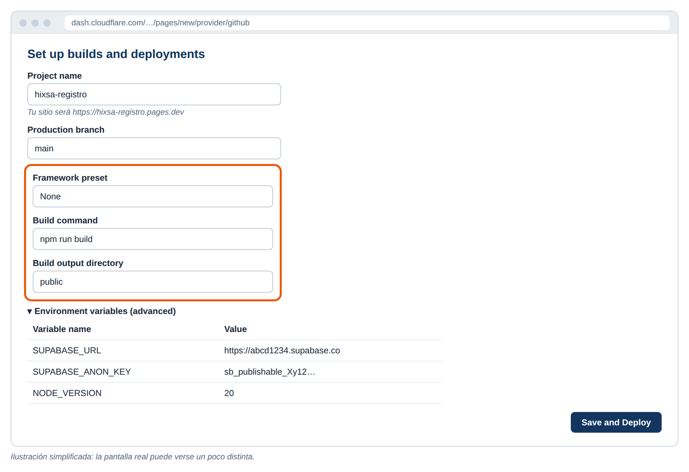
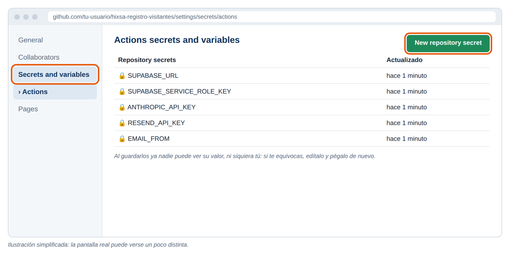
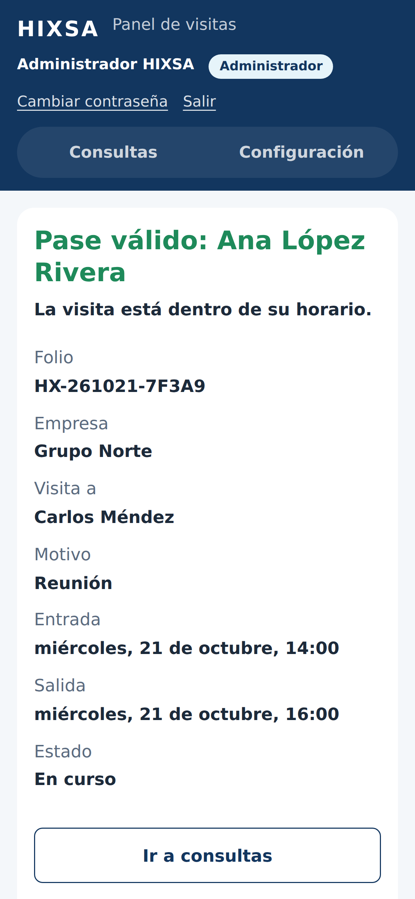

# Guía de despliegue paso a paso (para principiantes)

**Proyecto:** Registro de visitas HIXSA
**Tiempo estimado:** 2 a 3 horas la primera vez
**No necesitas saber programar.** Solo copia, pega y sigue los pasos en orden.

## Cómo usar esta guía

- Haz los capítulos **en orden**. Cada uno usa algo del anterior.
- Cada paso termina con **“Qué deberías ver”**. Si no ves eso, no avances: revisa la sección *Problemas comunes* al final.
- Las cajas oscuras son **comandos**: cópialos completos y pégalos en la terminal de VS Code. Presiona **Enter** después de cada uno.
- Donde dice `TU-ALGO` (por ejemplo `TU-USUARIO`), reemplázalo con tu dato real, sin dejar los guiones ni las mayúsculas.
- Las imágenes de los servicios son **ilustraciones simplificadas** que te muestran dónde hacer clic. Los botones marcados en naranja son los que debes buscar.



## Tu hoja de datos

Durante la guía vas a obtener varios datos. **Anótalos en un archivo privado** (no lo compartas ni lo subas a internet). Te los pediremos después.

| Dato | Dónde lo obtienes | Ejemplo | ¿Secreto? |
|---|---|---|---|
| Project URL de Supabase | Capítulo 2, paso 2.5 | `https://abcd1234.supabase.co` | No |
| Project ref | Capítulo 2, paso 2.5 | `abcd1234` | No |
| Publishable key | Capítulo 2, paso 2.5 | `sb_publishable_Xy12…` | No |
| Secret key | Capítulo 2, paso 2.5 | `sb_secret_…` | **Sí** |
| Contraseña del administrador | Capítulo 2, paso 2.3 | (la que elijas) | **Sí** |
| Llave de Resend | Capítulo 3, paso 3.2 | `re_AbC123…` | **Sí** |
| Llave de la API de Claude | Capítulo 7, paso 7.1 | `sk-ant-…` | **Sí** |
| URL del sitio | Capítulo 6 | `https://hixsa-registro.pages.dev` | No |

---

# Capítulo 1. VS Code: prepara tu computadora

VS Code es el programa donde vas a abrir el proyecto y escribir los comandos. Solo se hace una vez.

## 1.1 Instala los programas

Descarga e instala estos tres programas, aceptando las opciones que vienen marcadas por defecto:

1. **Visual Studio Code**: <https://code.visualstudio.com>
2. **Git** (guarda versiones y sube el código a GitHub): <https://git-scm.com/downloads>
3. **Node.js**, versión **LTS** (ejecuta los scripts del proyecto): <https://nodejs.org>

> En Windows, al instalar Git, deja marcada la opción “Git from the command line and also from 3rd-party software”.

**Qué deberías ver:** los tres programas aparecen en tu menú de inicio o en Aplicaciones.

## 1.2 Descomprime el proyecto

1. Busca el archivo `hixsa-registro-visitantes.zip` que descargaste.
2. Clic derecho → **Extraer todo** (Windows) o doble clic (Mac).
3. Mueve la carpeta `hixsa-registro-visitantes` a un lugar fácil, por ejemplo **Documentos**.

> La carpeta contiene una subcarpeta oculta llamada `.git` con el historial de cambios. No la borres: la necesitas para el entregable de GitHub.

## 1.3 Abre el proyecto en VS Code

1. Abre VS Code.
2. Menú **Archivo → Abrir carpeta…** (en Mac: **File → Open Folder…**).
3. Elige la carpeta `hixsa-registro-visitantes` y haz clic en **Seleccionar carpeta**.
4. Si VS Code pregunta *“¿Confía en los autores de los archivos?”*, elige **Sí, confío**.

**Qué deberías ver:** a la izquierda, la lista de carpetas del proyecto (`docs`, `public`, `scripts`, `supabase`…).

## 1.4 Abre la terminal

Menú **Terminal → Nueva terminal**. Se abre un panel abajo: ahí vas a pegar todos los comandos de esta guía.



Escribe estos dos comandos para confirmar que todo quedó instalado:

```bash
git --version
node --version
```

**Qué deberías ver:** algo como `git version 2.4x` y `v20.x` o `v22.x`. Si dice *“no se reconoce como comando”*, cierra VS Code por completo, ábrelo otra vez y repite.

## 1.5 Preséntate con Git (solo la primera vez)

Cambia el nombre y el correo por los tuyos (usa el mismo correo de tu cuenta de GitHub):

```bash
git config --global user.name "Tu Nombre"
git config --global user.email "tu-correo@ejemplo.com"
```

**Qué deberías ver:** nada. Si no aparece ningún error, quedó guardado.

---

# Capítulo 2. Supabase: base de datos y usuario administrador

Supabase guarda las visitas, maneja el inicio de sesión del personal y ejecuta la lógica del servidor.

## 2.1 Crea tu cuenta y el proyecto

1. Entra a <https://supabase.com> y haz clic en **Start your project**. Puedes registrarte con tu cuenta de GitHub.
2. Haz clic en **New project**.
3. Llena el formulario:
   - **Name:** `hixsa-visitantes`
   - **Database Password:** haz clic en **Generate a password** y **anótala** en tu hoja de datos.
   - **Region:** *East US (North Virginia)* o la más cercana a México.
4. Haz clic en **Create new project** y espera de 1 a 2 minutos.

**Qué deberías ver:** el panel de tu proyecto con un menú a la izquierda (Table Editor, SQL Editor, Authentication…).

## 2.2 Crea las tablas

1. En el menú izquierdo, haz clic en **SQL Editor**.
2. Haz clic en **New query** (o en el **+**).
3. En VS Code, abre el archivo `supabase/schema.sql`, selecciona todo (**Ctrl + A**, en Mac **Cmd + A**) y cópialo (**Ctrl + C**).
4. Regresa a Supabase, pega el texto en el editor y haz clic en **Run**.



**Qué deberías ver:** el mensaje **Success. No rows returned**. Luego, en **Table Editor**, aparecen cuatro tablas: `visitantes`, `perfiles`, `configuracion` y `bitacora_reportes`.

> Si aparece un aviso sobre “operaciones destructivas”, confirma con **Run this query**: el script está hecho para poder ejecutarse más de una vez sin borrar datos.

## 2.3 Crea el usuario administrador

1. En el menú izquierdo: **Authentication → Users**.
2. Haz clic en **Add user → Create new user**.
3. Escribe:
   - **Email:** `admin@hixsa.com` (o el correo que prefieras).
   - **Password:** una contraseña segura. **Anótala.**
   - Marca la casilla **Auto Confirm User**.
4. Haz clic en **Create user**.



## 2.4 Dale permisos de administrador

1. Regresa a **SQL Editor → New query**.
2. En VS Code abre `supabase/crear-admin.sql`, copia todo y pégalo.
3. Si en el paso anterior usaste un correo distinto a `admin@hixsa.com`, cámbialo en la línea que dice `where email = 'admin@hixsa.com'`.
4. Haz clic en **Run**.

**Qué deberías ver:** una tabla con una fila: tu correo, `Administrador HIXSA`, `admin`, `true`.

## 2.5 Copia tus llaves

1. En el menú izquierdo: **Project Settings** (ícono de engrane) → **API Keys**. También puedes usar el botón **Connect** que está arriba.
2. Copia a tu hoja de datos:
   - **Project URL**, por ejemplo `https://abcd1234.supabase.co`.
   - **Project ref**: es la parte `abcd1234` de esa URL.
   - **Publishable key** (empieza con `sb_publishable_`). Si solo ves llaves que empiezan con `eyJ`, usa la que dice **anon public**.
   - **Secret key** (empieza con `sb_secret_`); se muestra al hacer clic en el ojo o en **Reveal**. Si solo ves llaves `eyJ`, usa la que dice **service_role**.



> **La Secret key es como la llave maestra de tu base de datos.** Nunca la pegues en el sitio web, en el código ni en un chat. Solo irá en los secretos de GitHub (Capítulo 7).

---

# Capítulo 3. Resend: la llave para enviar correos

Resend envía al visitante el correo con su pase QR.

## 3.1 Crea tu cuenta

1. Entra a <https://resend.com> y haz clic en **Get Started**.
2. Regístrate **con el mismo correo donde quieres recibir las pruebas**.

## 3.2 Crea una llave

1. En el menú izquierdo: **API Keys → Create API Key**.
2. **Name:** `hixsa-visitas`. **Permission:** *Sending access*.
3. Haz clic en **Add** y **copia la llave** (empieza con `re_`). Solo se muestra una vez.



## 3.3 Entiende el límite de prueba

Mientras no verifiques un dominio, Resend **solo entrega correos al correo de tu propia cuenta**. Para la demo es suficiente: registra las visitas de prueba con ese correo.

> **Para producción** (enviar pases a cualquier visitante): en Resend ve a **Domains → Add Domain**, escribe un subdominio como `visitas.hixsa.com` y pide al área de sistemas que agregue en el DNS los registros que Resend muestra. Cuando aparezca como **Verified**, podrás usar un remitente como `recepcion@visitas.hixsa.com`.

---

# Capítulo 4. Supabase, parte 2: funciones del servidor

Las funciones son el “cerebro” del sistema: guardan el registro, generan el QR, envían el correo, dan de alta usuarios y mandan reportes. Se suben desde la terminal de VS Code.

## 4.1 Conecta la terminal con tu cuenta de Supabase

En la terminal de VS Code:

```bash
npx supabase login
```

1. Si pregunta *“Need to install the following packages… Ok to proceed?”*, escribe `y` y presiona Enter.
2. Se abre el navegador: inicia sesión y autoriza.
3. Regresa a VS Code.

**Qué deberías ver:** `You are now logged in. Happy coding!`

## 4.2 Enlaza este proyecto con tu proyecto de Supabase

Cambia `TU_PROJECT_REF` por tu project ref (por ejemplo `abcd1234`):

```bash
npx supabase link --project-ref TU_PROJECT_REF
```

Si te pide la contraseña de la base de datos, pega la del paso 2.1.

**Qué deberías ver:** `Finished supabase link.`

## 4.3 Guarda los secretos de las funciones

Elige desde ahora el nombre de tu sitio en Cloudflare; en esta guía usamos `hixsa-registro`, así que la dirección será `https://hixsa-registro.pages.dev`. Si al final Cloudflare te da otra, la corriges en el paso 6.5.

Ejecuta estos comandos **uno por uno**, cambiando los valores:

```bash
npx supabase secrets set RESEND_API_KEY=re_TU_LLAVE_DE_RESEND
npx supabase secrets set EMAIL_FROM="HIXSA Recepción <onboarding@resend.dev>"
npx supabase secrets set PUBLIC_SITE_URL=https://hixsa-registro.pages.dev
npx supabase secrets set ALLOWED_ORIGIN=*
```

> `onboarding@resend.dev` sirve para pruebas. Cuando verifiques tu dominio, repite el comando de `EMAIL_FROM` con tu correo real. `ALLOWED_ORIGIN=*` permite probar desde tu computadora; en el paso 6.5 lo cerramos a tu sitio.

**Qué deberías ver:** `Finished supabase secrets set.` después de cada comando.

## 4.4 Sube las tres funciones

```bash
npx supabase functions deploy registrar-visita --no-verify-jwt
npx supabase functions deploy admin-usuarios --no-verify-jwt
npx supabase functions deploy enviar-reporte --no-verify-jwt
```

**Qué deberías ver:** `Deployed Functions on project …: registrar-visita` (y lo mismo para las otras dos). En Supabase, en **Edge Functions**, aparecen las tres.

> Si aparece un aviso sobre **Docker** pero al final dice `Deployed Functions`, todo está bien. Si se detiene con un error de Docker, repite el comando agregando ` --use-api` al final.

## 4.5 Prueba el sitio en tu computadora

1. Crea tu archivo de configuración local:

```bash
cp .env.example .env
```

2. En VS Code abre el archivo `.env` (aparece en la lista de la izquierda) y cambia las dos primeras líneas por tus datos:

```text
SUPABASE_URL=https://abcd1234.supabase.co
SUPABASE_ANON_KEY=sb_publishable_Xy12...
```

3. Guarda el archivo (**Ctrl + S**) y arranca el sitio:

```bash
npm run dev
```

4. Abre <http://localhost:3000> en tu navegador. Registra una visita usando **el correo de tu cuenta de Resend**.

**Qué deberías ver:** la pantalla con tu folio y tu código QR, y unos segundos después el correo con el pase.


5. Abre <http://localhost:3000/admin.html>, entra con el correo y la contraseña del administrador y revisa que tu visita aparezca en **Consultas**.
6. Para detener el sitio local, haz clic en la terminal y presiona **Ctrl + C**.

> El archivo `.env` es privado: Git lo ignora automáticamente y nunca se sube a GitHub.

---

# Capítulo 5. GitHub: sube el código

GitHub guarda tu código con todo su historial. Es el **Entregable 1** del curso.

## 5.1 Crea tu cuenta

Entra a <https://github.com> y haz clic en **Sign up**. Verifica tu correo.

## 5.2 Crea un repositorio vacío

1. Entra a <https://github.com/new>.
2. **Repository name:** `hixsa-registro-visitantes`.
3. Elige **Public** (facilita la revisión del curso) o **Private**.
4. **No marques** *Add a README*, *Add .gitignore* ni *Choose a license*. El proyecto ya los tiene.
5. Haz clic en **Create repository**.



## 5.3 (Opcional) Pon tu nombre como autor de los cambios

Los cambios del proyecto dicen “Equipo HIXSA”. Para que aparezcan con tu nombre (el que configuraste en el paso 1.5):

```bash
git rebase -r --root --exec "git commit --amend --no-edit --reset-author"
```

**Qué deberías ver:** `Successfully rebased and updated refs/heads/main.`

## 5.4 Conecta y sube

Cambia `TU-USUARIO` por tu usuario de GitHub:

```bash
git remote add origin https://github.com/TU-USUARIO/hixsa-registro-visitantes.git
git push -u origin main
```

1. La primera vez se abre una ventana para **iniciar sesión en GitHub**: elige **Sign in with your browser** y autoriza.
2. Recarga la página de tu repositorio en GitHub.

**Qué deberías ver:** todos los archivos del proyecto y, arriba a la derecha, el número de **commits** (12 o más). Haz clic ahí para ver el historial.

> Si en la terminal aparece `error: remote origin already exists`, ejecuta `git remote remove origin` y repite los dos comandos.

## 5.5 Revisa la verificación automática

Haz clic en la pestaña **Actions** de tu repositorio.

**Qué deberías ver:** una ejecución llamada **Verificación** con una palomita verde. Revisa sola el código cada vez que subes cambios.

## 5.6 Cómo guardar cambios después

Cada vez que modifiques algo:

```bash
git add .
git commit -m "fix: describe en pocas palabras qué cambiaste"
git push
```

---

# Capítulo 6. Cloudflare: publica el sitio

Cloudflare Pages pone tu sitio en internet y lo actualiza solo cada vez que haces `git push`.

## 6.1 Crea tu cuenta

Entra a <https://dash.cloudflare.com/sign-up> y regístrate con tu correo. Verifícalo.

## 6.2 Conecta tu repositorio

1. En el menú izquierdo: **Workers & Pages** (en algunas cuentas está dentro de **Compute**).
2. Haz clic en **Create** y elige la pestaña **Pages**.
   Si solo ves opciones de *Workers*, busca el enlace *“Looking to deploy Pages? Get started”*.
3. Elige **Import an existing Git repository** → **Connect GitHub**.
4. En la ventana de GitHub elige **Only select repositories**, selecciona `hixsa-registro-visitantes` y haz clic en **Install & Authorize**.
5. De regreso en Cloudflare, selecciona el repositorio y haz clic en **Begin setup**.

## 6.3 Configura la publicación

Llena exactamente así:

| Campo | Valor |
|---|---|
| Project name | `hixsa-registro` |
| Production branch | `main` |
| Framework preset | `None` |
| Build command | `npm run build` |
| Build output directory | `public` |

Abre **Environment variables (advanced)** y agrega tres variables con **+ Add variable**:

| Variable name | Value |
|---|---|
| `SUPABASE_URL` | tu Project URL |
| `SUPABASE_ANON_KEY` | tu **Publishable key** (la pública, nunca la secreta) |
| `NODE_VERSION` | `20` |



Haz clic en **Save and Deploy**.

## 6.4 Espera la publicación

**Qué deberías ver:** un registro de texto que avanza y termina en **Success: Your site is deployed!**. Entre las líneas aparece `✔ public/config.js generado para https://…supabase.co`.

Anota tu dirección, por ejemplo `https://hixsa-registro.pages.dev`. Ábrela: debe aparecer el formulario.

## 6.5 Cierra el acceso de las funciones a tu sitio

Regresa a la terminal de VS Code y ejecuta, con tu dirección real (**sin `/` al final**):

```bash
npx supabase secrets set ALLOWED_ORIGIN=https://hixsa-registro.pages.dev
npx supabase secrets set PUBLIC_SITE_URL=https://hixsa-registro.pages.dev
```

Normalmente los secretos se aplican en unos segundos. Si después de un minuto el formulario publicado dice “No hay conexión con el servidor”, repite los tres comandos del paso 4.4.

> Con esto, solo tu sitio publicado puede usar las funciones. Si después quieres probar otra vez en tu computadora (`npm run dev`), vuelve a poner `ALLOWED_ORIGIN=*` mientras pruebas.

---

# Capítulo 7. GitHub, parte 2: reporte diario automático

Este es el **Entregable 3**: cada día hábil a las 7:00 GitHub genera el reporte con la API de Claude y lo envía por correo.

## 7.1 Consigue la llave de la API de Claude

1. Entra a <https://console.anthropic.com> y crea tu cuenta.
2. Ve a **API Keys → Create Key**, ponle de nombre `hixsa-reporte` y copia la llave (empieza con `sk-ant-`).
3. En **Billing**, agrega saldo si tu cuenta lo pide.

> Si no tienes llave, el reporte se envía igual con un resumen básico sin IA.

## 7.2 Guarda los secretos en GitHub

1. En tu repositorio: **Settings → Secrets and variables → Actions**.
2. Haz clic en **New repository secret** y crea estos cinco, uno por uno (**Name** exactamente como aparece, **Secret** con tu valor):

| Name | Secret |
|---|---|
| `SUPABASE_URL` | tu Project URL |
| `SUPABASE_SERVICE_ROLE_KEY` | tu **Secret key** de Supabase |
| `ANTHROPIC_API_KEY` | tu llave de Claude |
| `RESEND_API_KEY` | tu llave de Resend |
| `EMAIL_FROM` | `HIXSA Recepción <onboarding@resend.dev>` |



## 7.3 Elige quién recibe el reporte

1. Entra a tu sitio: `https://hixsa-registro.pages.dev/admin.html` con el administrador.
2. Pestaña **Configuración → Correos → Destinatarios del reporte**: escribe un correo por línea (para pruebas, el de tu cuenta de Resend).
3. Haz clic en **Guardar correos**.

## 7.4 Pruébalo sin esperar a mañana

1. En GitHub: pestaña **Actions** → a la izquierda, **Reporte diario de visitas**.
2. Botón **Run workflow** → deja *dry run* sin marcar → **Run workflow**.

**Qué deberías ver:** en uno o dos minutos, una palomita verde y el correo con el reporte en tu bandeja.

---

# Capítulo 8. Prueba final y entrega

## 8.1 Prueba completa

1. **Desde tu celular**, abre tu sitio y registra una visita para dentro de una hora.
2. Revisa que llegue el correo con el pase QR.
3. **Con otro celular**, escanea el QR con la cámara. Se abre el panel: inicia sesión.



4. En **Consultas**, elige **Hoy** y verifica que aparezca la visita.
5. En **Configuración**, agrega un usuario de consulta. Copia la contraseña temporal que aparece.
6. Cierra sesión y entra con ese usuario: debe ver **Consultas** pero **no** **Configuración**.


## 8.2 MCP y skill en Claude Code (Entregable 2)

1. Instala Claude Code siguiendo <https://docs.claude.com/en/docs/claude-code/overview>.
2. En la terminal de VS Code, guarda tu project ref y abre Claude Code:

Windows (PowerShell):

```bash
$env:SUPABASE_PROJECT_REF="TU_PROJECT_REF"
claude
```

Mac:

```bash
export SUPABASE_PROJECT_REF=TU_PROJECT_REF
claude
```

3. Claude Code pregunta si quieres usar el servidor MCP `supabase` del proyecto: acepta.
4. Escribe `/mcp`, elige `supabase` y autentícate en el navegador con tu cuenta de Supabase.
5. Escribe: *Genera el reporte semanal de visitas*.

**Qué deberías ver:** Claude Code consulta tus datos reales y guarda el reporte en la carpeta `reportes/`.

## 8.3 Lista de entrega

- [ ] Enlace al repositorio de GitHub (historial de commits y Actions en verde)
- [ ] Enlace al sitio: `https://hixsa-registro.pages.dev`
- [ ] Usuario de consulta de prueba para quien evalúe
- [ ] Capturas: correo con el pase, panel, `/mcp` conectado y el reporte diario
- [ ] Presentación: `docs/Presentacion_Direccion_Registro_Visitas.pptx`

---

# Problemas comunes

| Lo que ves | Por qué pasa | Qué hacer |
|---|---|---|
| `no se reconoce como comando` (git, node o npx) | La terminal se abrió antes de instalar | Cierra VS Code por completo y ábrelo de nuevo |
| En PowerShell: *“la ejecución de scripts está deshabilitada”* | Política de Windows | Ejecuta `Set-ExecutionPolicy -Scope CurrentUser RemoteSigned`, responde `S` y repite |
| `npx supabase link` pide contraseña y falla | Contraseña de base de datos incorrecta | En Supabase: **Project Settings → Database → Reset database password** |
| El formulario dice “No hay conexión con el servidor” | Funciones no subidas o `ALLOWED_ORIGIN` distinto | Repite 4.4; revisa que `ALLOWED_ORIGIN` sea tu dirección exacta, sin `/` final, o `*` si pruebas en tu computadora |
| El registro funciona pero no llega el correo | Resend en modo de prueba | Usa el correo de tu cuenta de Resend o verifica tu dominio (3.3). En el panel la visita dice “Error de envío” |
| “Tu cuenta no tiene acceso al panel” | El usuario no tiene permisos | Repite el paso 2.4 con el correo correcto |
| “Correo o contraseña incorrectos” | Datos distintos a los del paso 2.3 | En **Authentication → Users**, menú de la fila → **Reset password** o crea el usuario de nuevo |
| Cloudflare falla con “Faltan variables” | Variables mal escritas | En Cloudflare: **Settings → Variables and Secrets**, corrige y luego **Deployments → Retry deployment** |
| `git push` dice *“Authentication failed”* | Sesión de GitHub no autorizada | Repite el comando y elige **Sign in with your browser** |
| `error: remote origin already exists` | Ya conectaste el repositorio antes | `git remote remove origin` y repite 5.4 |
| El reporte diario falla con 401 | Secret key incorrecta en GitHub | Edita `SUPABASE_SERVICE_ROLE_KEY` y vuelve a ejecutar |
| `/mcp` no muestra `supabase` | Falta el project ref | Repite 8.2 en la misma terminal y reinicia Claude Code |

# Glosario rápido

| Palabra | Qué significa |
|---|---|
| Terminal | Ventana donde escribes comandos de texto. En VS Code está abajo. |
| Repositorio | Carpeta de un proyecto guardada en GitHub con todo su historial. |
| Commit | Una versión guardada del proyecto, con una descripción del cambio. |
| Push | Subir tus commits a GitHub. |
| Deploy (desplegar) | Publicar algo para que funcione en internet. |
| Edge Function | Pequeño programa que corre en los servidores de Supabase. |
| Variable de entorno / secreto | Un dato de configuración (como una llave) que se guarda fuera del código. |
| RLS | Reglas de Supabase que deciden quién puede ver o cambiar cada dato. |
| MCP | Forma estándar de conectar Claude Code con herramientas y datos externos. |
