# Manual del personal

**Registro de visitas HIXSA, versión 4.1**
Uso del panel interno: Recepción, Tablero, Consultas, Reportes y Configuración.

## 1. Acceso al panel

1. Abre `https://hixsa-registro-visitantes.mcrayor.workers.dev/admin/` (o el botón **Acceso para personal** de la página de registro).
2. Entra con tu **correo y contraseña**. Solo pueden entrar las personas dadas de alta en **Configuración → Usuarios**.
3. La primera vez cambia tu contraseña temporal con **Cambiar contraseña** (arriba a la derecha). Mínimo 10 caracteres.

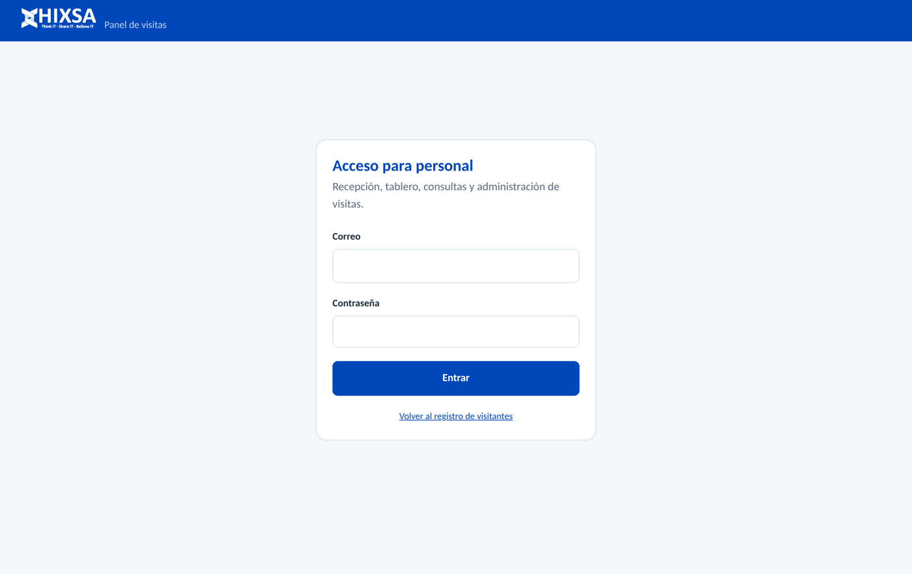

### Roles

Lo que ves depende de tu rol. El SUPERADMIN puede ajustar los permisos en **Configuración → Roles**.

| Rol | Secciones | Fechas que consulta | Exporta |
|---|---|---|---|
| SUPERADMIN | Todas (incluye Roles y borrado de perfiles) | Sin límite | Sí |
| ADMIN | Todas excepto Roles | Sin límite | Sí |
| SUPERVISOR | Recepción, Tablero, Consultas, Reportes | 7 días atrás y 7 adelante | No |
| RECEPCIÓN | Recepción, Consultas | Solo hoy | No |
| CONSULTA | Tablero, Consultas, Reportes | Sin límite | No |

Cuando el **modo auditoría** está activo, la barra superior muestra una etiqueta amarilla y **todo el panel muestra solo HIXSA**.

---

## 2. Recepción

Pensada para **celular o tablet** en el mostrador.

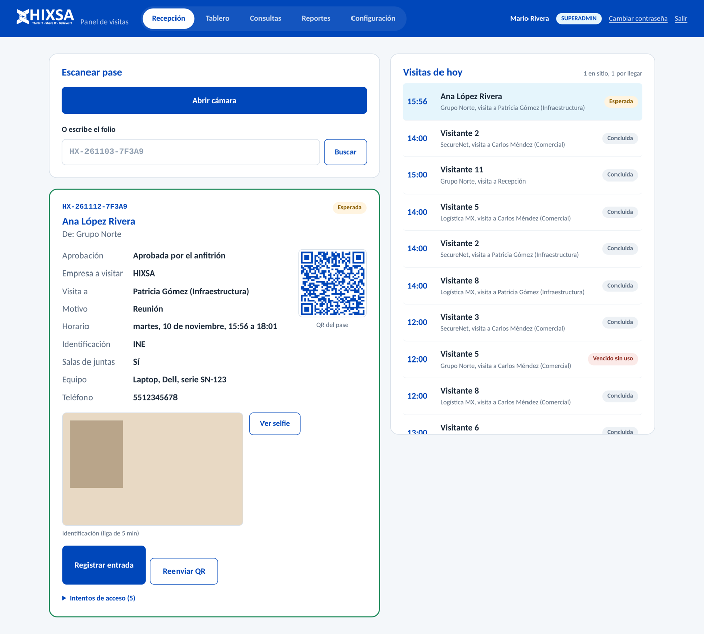

### 2.1 Encontrar la visita

- **Abrir cámara** y apunta al QR del visitante (la primera vez acepta el permiso de cámara del navegador), o
- escribe el **folio** y toca **Buscar**, o
- toca a la persona en **Visitas de hoy**, que muestra el rango de horas de cada visita (por ejemplo, `10:30 – 12:30`).

También puedes escanear el QR con la cámara normal de un celular: abre el panel directo en la ficha.

### 2.2 La ficha

Muestra:
- **Pase auténtico** cuando el QR coincide con el registro.
- Datos de la visita, empresa a visitar, anfitrión y estado de **aprobación**.
- **QR** del pase y botones **Ver identificación** y **Ver selfie** (enlaces que caducan en 5 minutos).
- **Alertas** del visitante: *No deseado* (amarillo), *Restringido* (naranja) o *Bloqueado* (rojo), con el motivo.
- **Intentos de acceso** anteriores.

### 2.3 Registrar la entrada

Toca **Registrar entrada**. El sistema valida en el servidor el **día y la hora**: se permite desde los minutos de llegada temprana configurados (10 por defecto) hasta la tolerancia (15 por defecto). Si todo está bien, registra la llegada y **avisa al anfitrión por correo**.

### 2.4 ACCESO NO PERMITIDO

Si algo no corresponde, aparece el aviso con el **motivo** y una **sugerencia**:

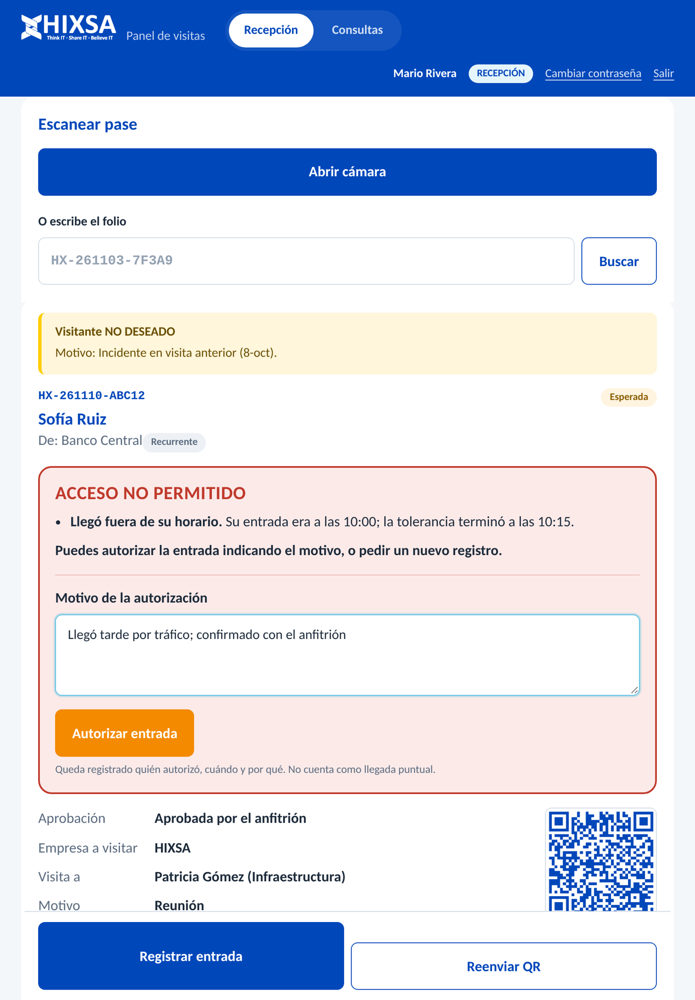

| Motivo | ¿Se puede autorizar? | Qué hacer |
|---|---|---|
| Llegó antes de su horario | Sí | Esperar, o autorizar con motivo. |
| Llegó fuera de su horario (tarde, el mismo día) | Sí | Autorizar con motivo (confirmar con el anfitrión). |
| Pendiente de aprobación del anfitrión | Sí | Confirmar con el anfitrión y autorizar con motivo. |
| Pendiente de validación (sin anfitrión) | — | Tocar **Aprobar visita** y volver a registrar la entrada. |
| Fecha no asignada / pase caducado | No | Pedir un nuevo registro. |
| Visitante bloqueado o restringido sin aprobación | No | No permitir el acceso. |
| El pase no coincide con el registro | No | Verificar identidad y pedir un nuevo registro. |

Para **autorizar**, escribe el motivo (mínimo 5 caracteres) y toca **Autorizar entrada**. Queda registrado quién autorizó, cuándo y por qué, y **no cuenta como llegada puntual**.

Un pase de **otro día** también muestra ACCESO NO PERMITIDO aunque tu rol solo vea el día de hoy:

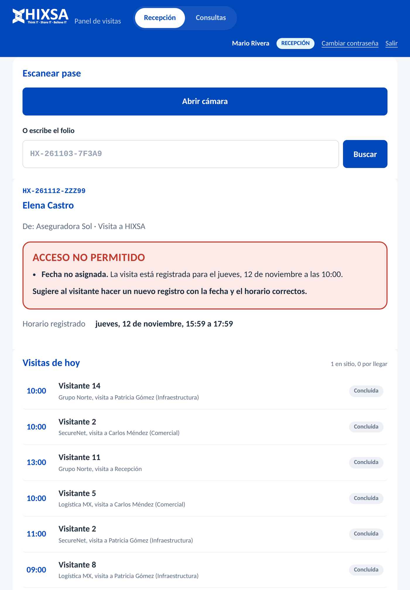

### 2.5 Registrar la salida y reenviar el QR

- **Registrar salida**: siempre permitida, a cualquier hora.
- **Reenviar QR**: vuelve a enviar el pase por correo (visitas vigentes).

En celular, el botón de acción queda **fijo abajo**:

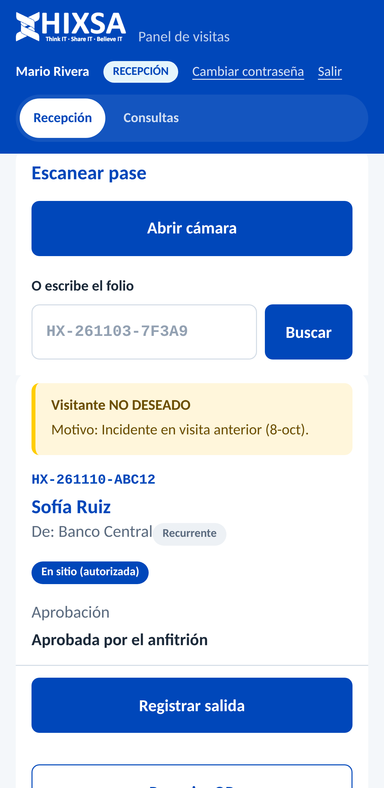

---

## 3. Tablero

Indicadores del periodo (últimos 7 o 30 días, este mes, mes anterior) y por empresa: asistencia, visitantes en sitio, duración real, visitas por día, hora de llegada, motivos, anfitriones y empresas.

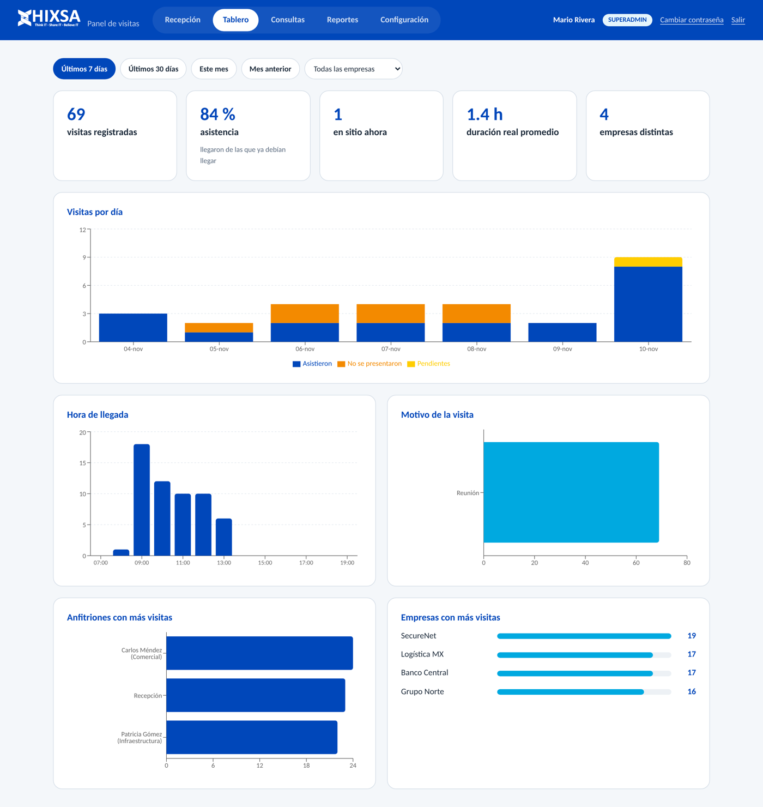

---

## 4. Consultas

Tres grupos. Lo que ves está limitado por las fechas de tu rol.

### 4.1 Por fecha

Filtra por periodo, empresa a visitar, motivo, empresa de origen o texto. Una **gráfica de dona** muestra el estado de las visitas del periodo. Vistas rápidas: **Todas**, **Quién estuvo** y **Sin salida registrada**. El encabezado muestra visitantes únicos y **duración promedio**. Toca una fila para abrir su ficha.

Con permiso de exportar: **CSV**, **PDF** y **Enviar por correo** (con CSV y PDF adjuntos).

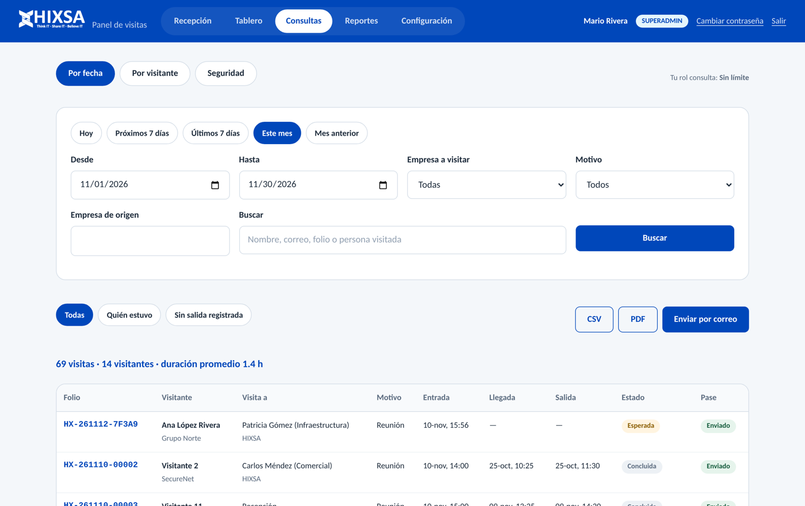

### 4.2 Por visitante

Busca por nombre o correo: verás su historial, el **estado actual de su invitación**, el botón **Reenviar QR** y **Nueva invitación**.

**Nueva invitación** (visitante recurrente, sin repetir datos): elige empresa, anfitrión, horario y motivo, y toca *Enviar invitación*. Se reutilizan sus datos e identificación, la invitación **queda aprobada**, se avisa al anfitrión y el visitante recibe un QR nuevo en su correo. El historial se conserva. Si el visitante está *restringido*, la debe aprobar el anfitrión.

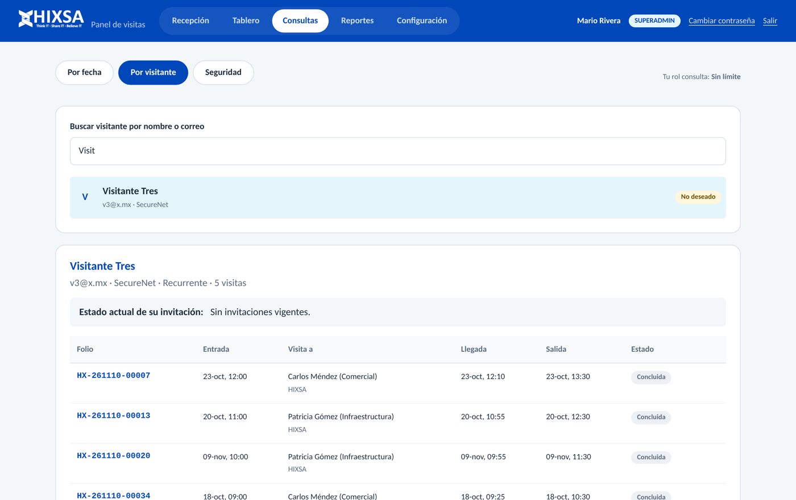

### 4.3 Seguridad

Visitantes **activos en este momento**, **QR usados fuera de horario**, **intentos con QR vencido** o de otra fecha, y **exportar el log de auditoría** (CSV o PDF).

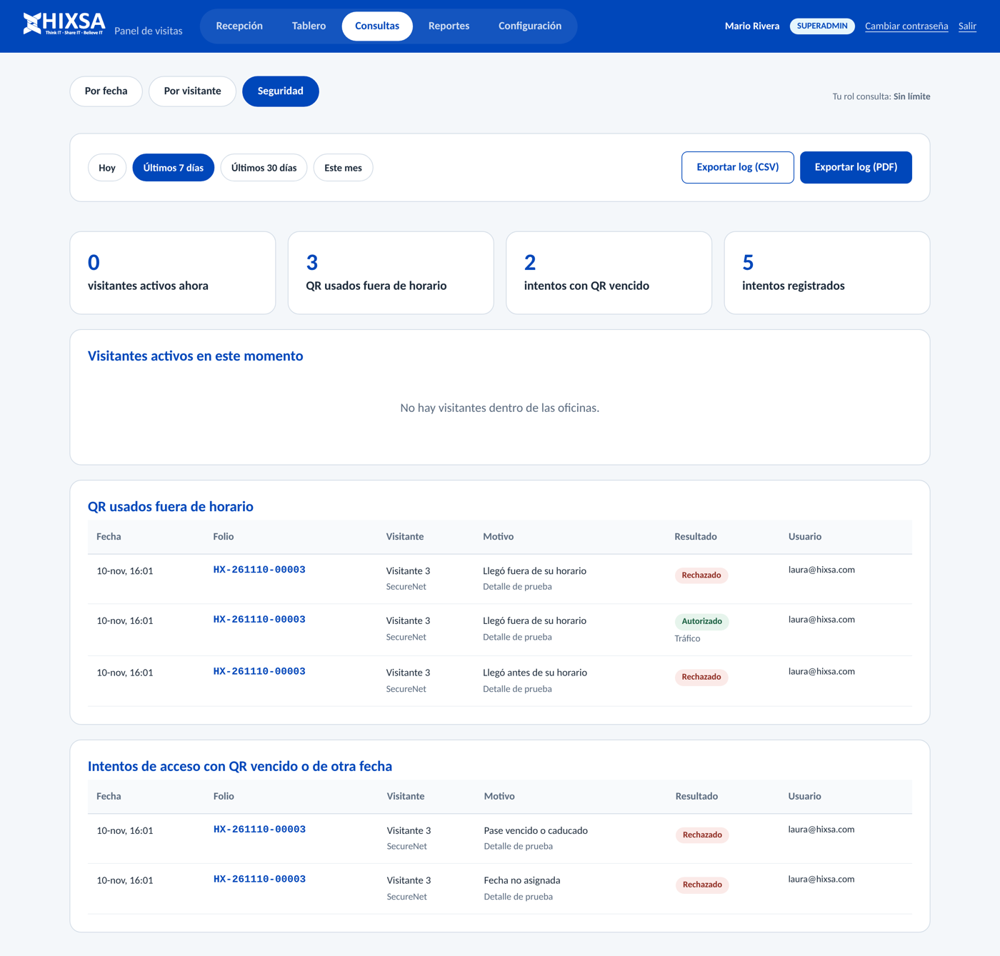

---

## 5. Reportes

Elige **Semanal** (la semana que contiene la fecha) o **Mensual**, y la empresa. Indicadores: **Total**, **Únicos**, **Puntual** (% de llegadas en horario) y **Exportar** (CSV, PDF o correo).

- **Semanal:** visitas por día (lunes a viernes), horas pico, nuevos contra recurrentes, invitaciones vencidas sin uso.
- **Mensual:** resumen consolidado, top 10 visitantes, ocupación por franja horaria, visitas por anfitrión y área.

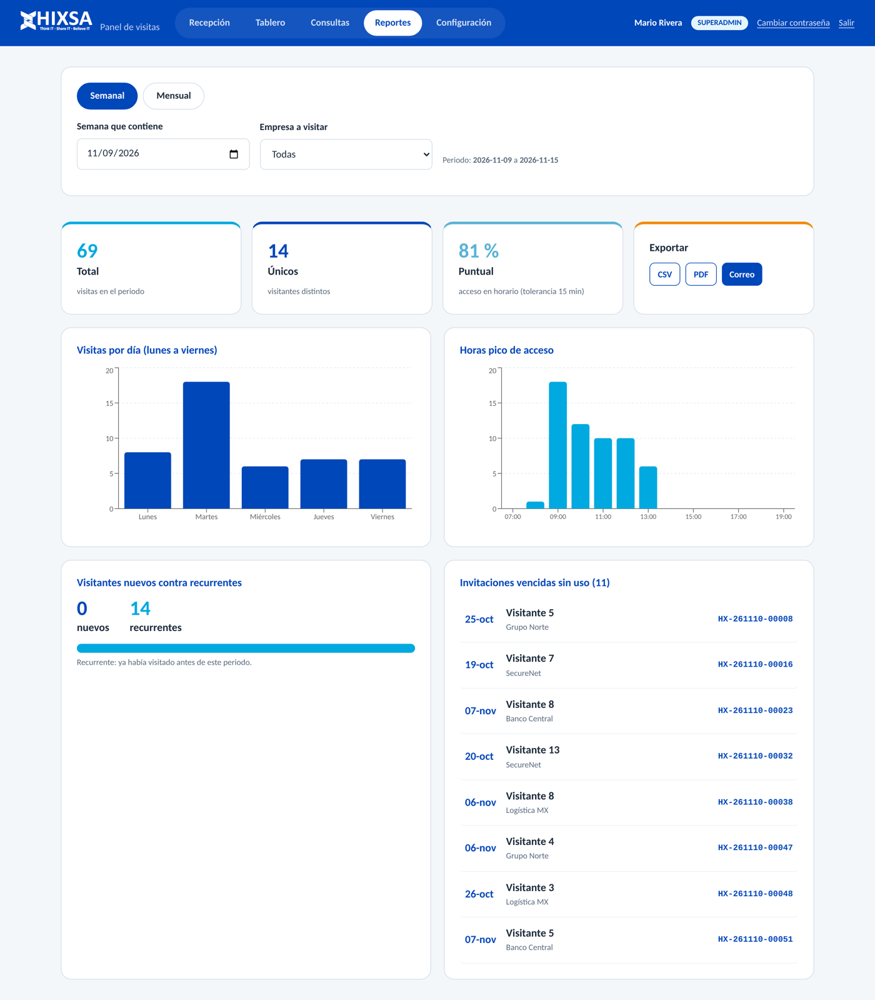

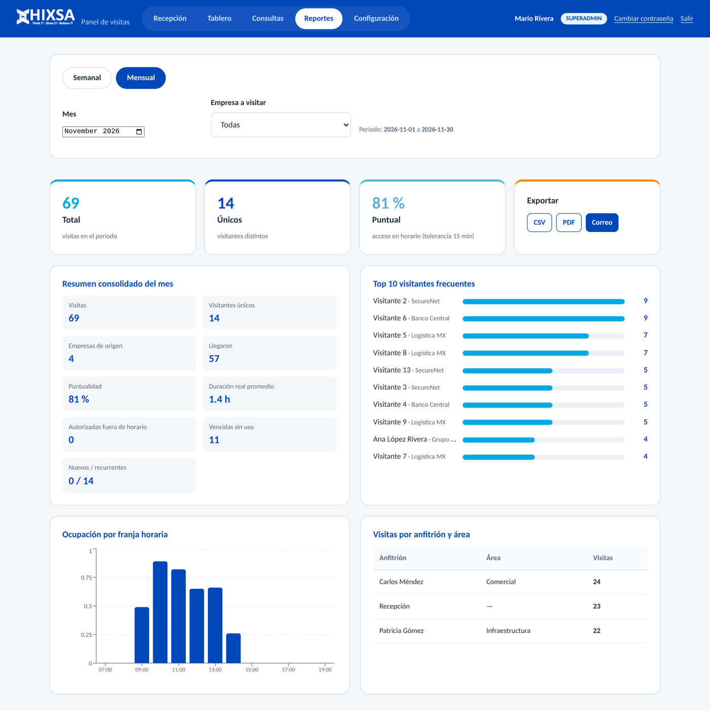

Además, el sistema envía **solo** un reporte **diario** (lunes a viernes 07:00) y uno **semanal** (lunes 07:05) a los destinatarios configurados. Si no llegó o quieres reenviarlo, usa **Enviar reporte a los destinatarios ahora** (arriba en Reportes): elige *Diario* o *Semanal* y la fecha.

---

## 6. Configuración

Cada apartado aparece según los permisos de tu rol. Los íconos de cada fila permiten **editar**, **activar/desactivar** y **eliminar**.

### 6.1 Usuarios

Alta de personal con su rol. Con el ícono de editar cambias **nombre, correo y celular** (el correo también es su usuario de acceso). Al crear un usuario se muestra una **contraseña temporal** (solo una vez): compártela por un canal seguro. Puedes desactivar, generar nueva contraseña y (SUPERADMIN) eliminar. Siempre debe quedar al menos un SUPERADMIN activo.

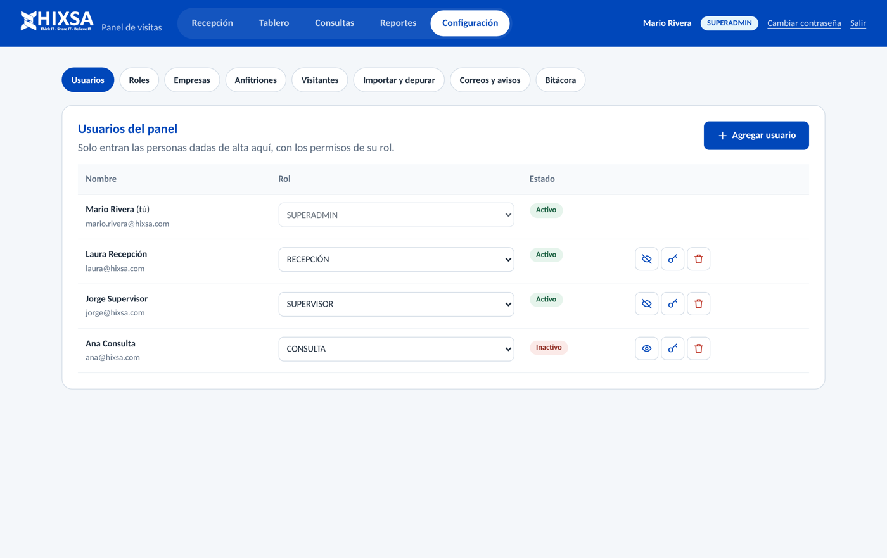

### 6.2 Roles (solo SUPERADMIN)

Crea y edita roles: secciones a las que entran, fechas que consultan y si exportan. El rol SUPERADMIN está protegido.

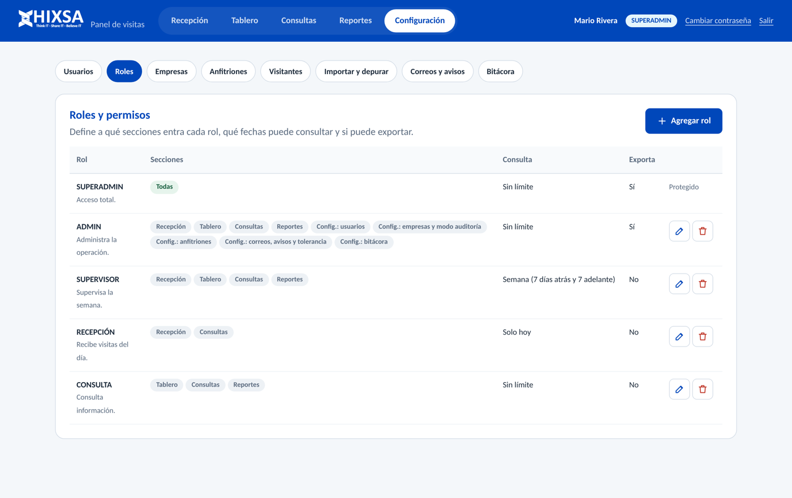

### 6.3 Empresas y modo auditoría

- **Modo auditoría**: con el interruptor, la bienvenida y el panel muestran solo la empresa principal.
- **Logo del sistema**: el de la bienvenida, el panel y los correos.
- **Empresas a visitar**: nombre, logotipo, si se muestra como *botón con logo* o en *lista*, orden y estado.

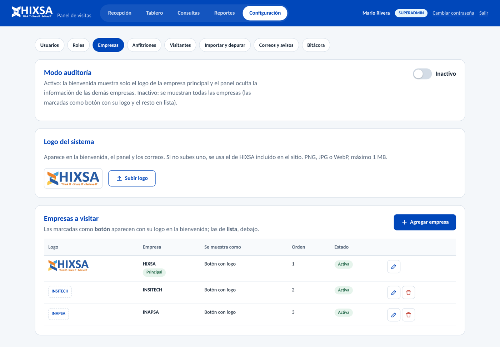

### 6.4 Anfitriones

Personas que reciben visitas: nombre, área, **correo para avisos y aprobaciones**, celular, foto y **empresas a las que pertenece** (en el formulario aparecen según la empresa elegida). Sin correo, el anfitrión no recibe avisos y Recepción valida sus visitas. La casilla de arriba permite mostrar en el formulario **solo el nombre** del anfitrión (sin apellidos).

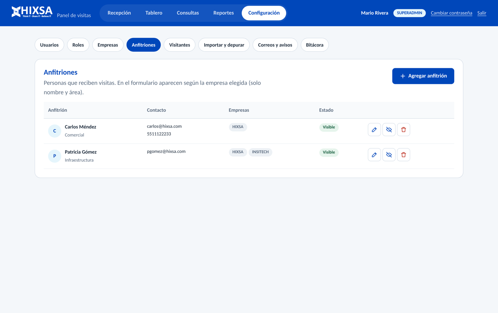

### 6.5 Visitantes y bloqueos

Perfiles de visitantes. Íconos de cada fila: **Editar datos** (nombre, correo, teléfono, empresa, identificación y selfie; aplica al perfil y a sus visitas próximas, y si cambias el correo se reenvían sus pases), **Nueva invitación** y **Cambiar estado**:

| Estado | Efecto |
|---|---|
| Sin restricción | Normal. |
| No deseado | Puede registrarse; Recepción ve una alerta. |
| Restringido | Cada visita requiere aprobación del anfitrión. |
| Bloqueado | No puede registrarse ni entrar. |

Cada cambio avisa por correo a los SUPERADMIN y a los anfitriones de sus visitas.

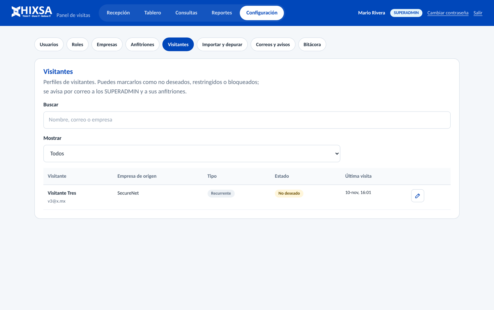

### 6.6 Importar y depurar

- **Importar** CSV de Glide (*visitantes.csv* primero, luego *Visitas.csv*) o la **plantilla HIXSA** (botón *Descargar plantilla CSV*). Muestra vista previa con errores y avisos, y **cuántas filas serán nuevas, se actualizarán o se omitirán**. Marca *Actualizar los registros ya importados* para sobrescribir con los datos del archivo (nunca toca visitas anonimizadas).
- **Borrado de perfiles** (solo SUPERADMIN): filtra por recurrentes / no recurrentes, sin visitas desde una fecha o empresa; revisa la **vista previa** y escribe *BORRAR*. Borra perfil y fotos y **anonimiza** el historial. No se puede deshacer.

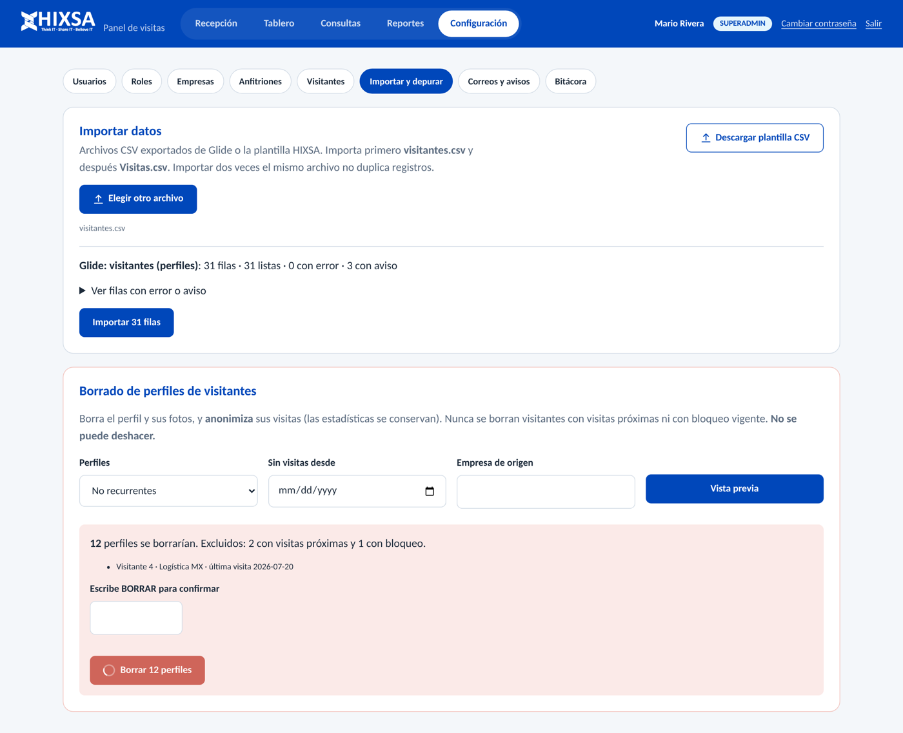

### 6.7 Correos y avisos

Correo de recepción y copia de pases, aviso al anfitrión, destinatarios de reportes, **correos para Google Calendar** (reciben todas las visitas), **llegada temprana** y **tolerancia** en minutos. El correo de recepción recibe todas las visitas en su calendario automáticamente; **Sincronizar visitas próximas** envía las invitaciones de las visitas ya registradas. El SUPERADMIN puede **enviar un reporte de prueba**.

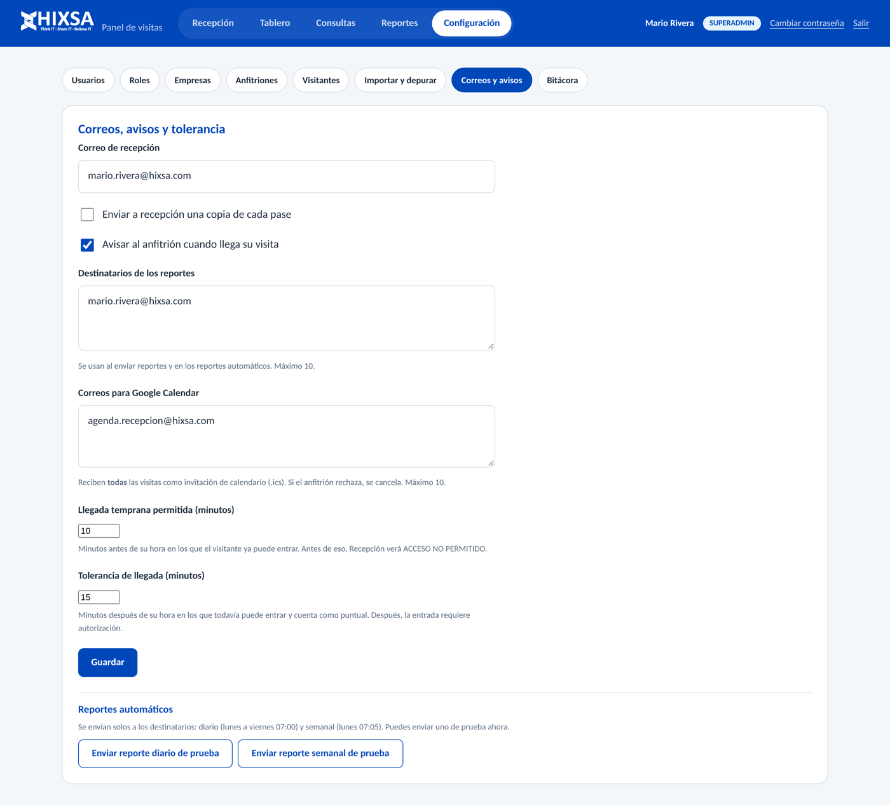

### 6.8 Bitácora

Quién cambió qué y cuándo, agrupado por día, con filtro de fechas y apartado y páginas de 25; y los reportes enviados.

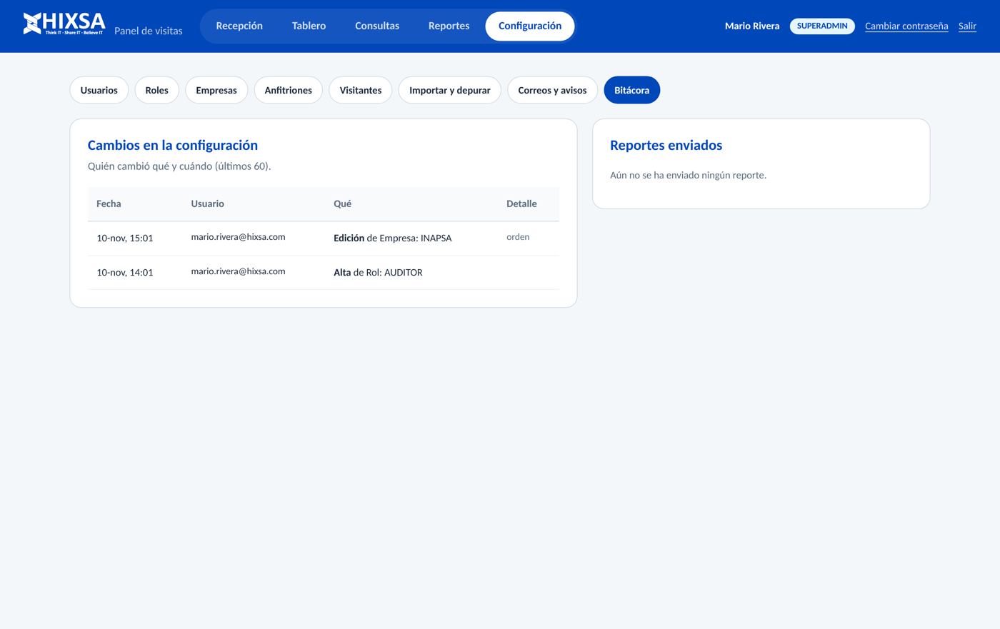

---

## 7. Correos que envía el sistema

| Correo | A quién | Cuándo |
|---|---|---|
| Pase con QR e invitación de calendario | Visitante (y copia a recepción si está activada) | Al registrarse o al reenviar |
| Solicitud de aprobación | Anfitrión | Al registrarse la visita |
| Visita confirmada / no autorizada | Visitante | Cuando el anfitrión responde |
| Invitación de calendario (y cancelación) | Correos para Google Calendar | En cada visita / si se rechaza |
| Aviso de llegada | Anfitrión | Al registrar la entrada |
| Código de verificación | Visitante recurrente | Al pedir recuperar sus datos |
| Aviso de bloqueo | SUPERADMIN y anfitriones | Al cambiar el estado de un visitante |
| Reporte diario / semanal | Destinatarios de reportes | L-V 07:00 / lunes 07:05 |

## 8. Preguntas frecuentes

| Pregunta | Respuesta |
|---|---|
| “Tu rol no tiene acceso…” | Pide al SUPERADMIN que revise tu rol en Configuración → Roles. |
| No veo visitas de otros días | Tu rol consulta solo hoy o la semana. |
| No veo INSITECH ni otras empresas | El modo auditoría está activo. |
| La cámara no abre | Permite la cámara en el candado junto a la dirección; requiere `https`. |
| El visitante no recibió su pase | En su ficha usa **Reenviar QR**; si sigue sin llegar, revisa la columna *Pase* en Consultas (error de envío). |
| Un anfitrión no aparece en el formulario | Revisa que esté visible y asignado a la empresa en Configuración → Anfitriones. |
