# Manual del visitante

**Registro de visitas HIXSA, versión 4.1**
Cómo registrar tu visita a las oficinas de HIXSA desde tu celular o computadora.

## Antes de tu visita

Ten a la mano:

- **Tu correo electrónico.** Ahí recibirás tu pase con código QR.
- **Una identificación oficial**: INE, licencia, pasaporte o credencial de tu empresa. Le tomarás una foto.
- **Tu celular con cámara**, si vas a entrar a salas de juntas (se pide una selfie).
- La **fecha y hora** de tu cita y el **nombre de la persona** que te recibe.

El registro toma unos 3 minutos. Hazlo **antes de llegar**: tu anfitrión debe aprobar la visita.

---

# Parte A. Registro en modo normal

Es el modo habitual: puedes elegir entre las empresas del grupo.

## A.1 Elige la empresa que visitas

Abre la liga de registro que te compartieron. Verás la pantalla de bienvenida:

- Las empresas principales aparecen **con su logotipo**: toca la que visitas.
- Las demás aparecen en la lista **“Otras empresas”**, con su logotipo pequeño.

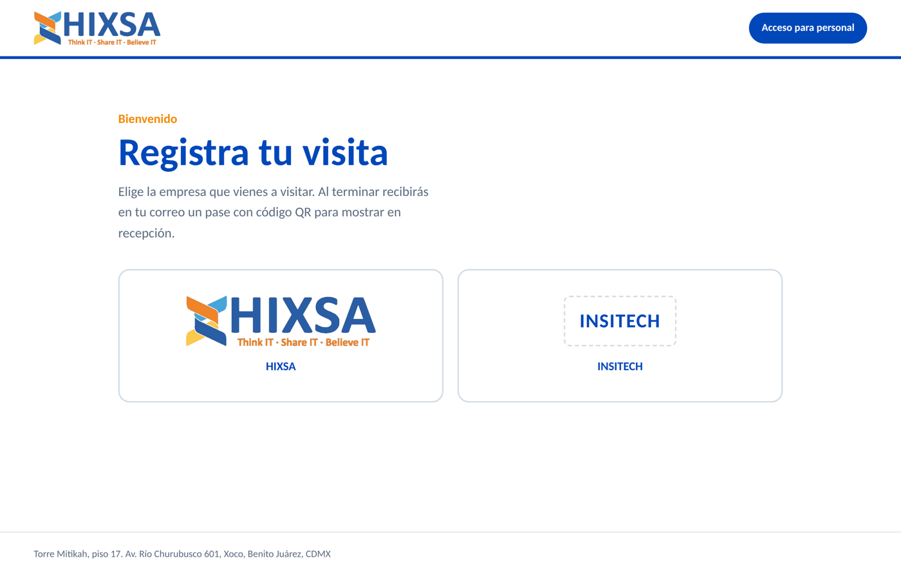

En celular se ve así:

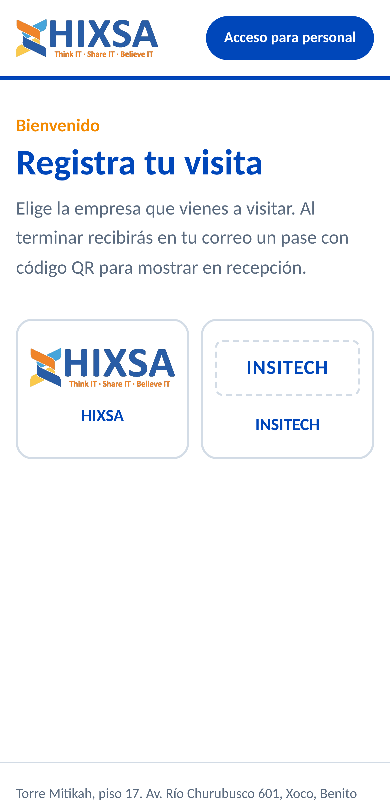

Al tocar una empresa se abre el formulario. Arriba aparece **“Visitas a”** con la empresa elegida; si te equivocaste, toca **Cambiar empresa**.

Después continúa con la **Parte C** (llenado del formulario).

---

# Parte B. Registro en modo auditoría

Durante una auditoría solo se registran visitas a **HIXSA**.

## B.1 Toca el logotipo de HIXSA

La bienvenida muestra únicamente el logotipo de HIXSA con el botón **Registrarse**. Tócalo y se abre el formulario con **HIXSA** ya seleccionada (en este modo no hay opción de cambiar de empresa).

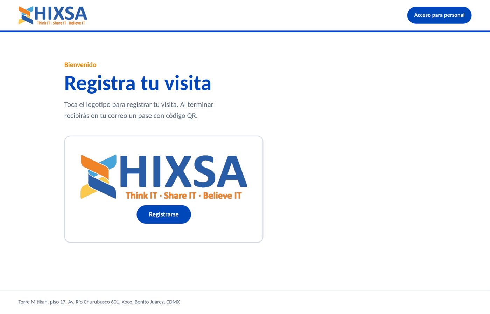

Después continúa con la **Parte C**: el formulario es el mismo en ambos modos.

---

# Parte C. Llenado del formulario

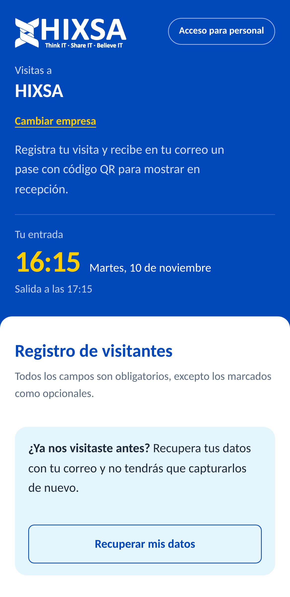

## C.1 Si ya nos visitaste: recupera tus datos

Si en otra visita marcaste **“Guardar mis datos”**, no tienes que capturarlos de nuevo:

1. Toca **Recuperar mis datos**.
2. Escribe tu correo y toca **Enviarme un código**.
3. Revisa tu correo (también la carpeta de *spam*): recibirás un **código de 6 dígitos**, válido por 10 minutos.
4. Escríbelo y toca **Verificar**.

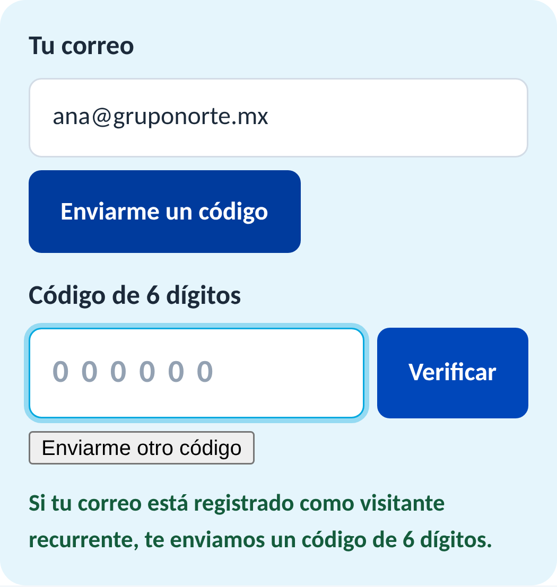

Si escribes directamente tu correo en el formulario, el código se envía solo y verás el mismo aviso; escríbelo y toca **Verificar**. Si es tu primera visita, ignóralo y sigue llenando el formulario.

Tus datos, tu identificación y tu selfie guardadas se cargan solas. Solo revisa que estén correctos y elige la nueva fecha, horario y anfitrión.

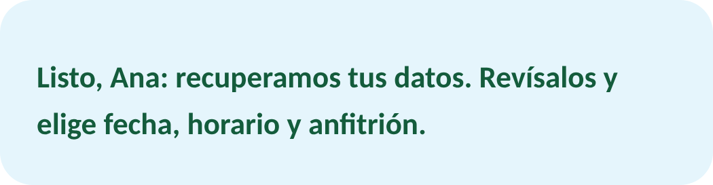

> Por tu privacidad, el sistema responde igual exista o no tu correo, y nunca muestra tus datos sin el código.

## C.2 Tus datos

- **Nombre(s)** y **Apellidos**, en campos separados.
- **Empresa de origen**: la empresa de donde vienes. Si vienes por tu cuenta escribe *Particular*; si entregas paquetes, *Repartidor*.
- **Teléfono** (10 dígitos) y **correo electrónico**.

## C.3 Identificación

1. Elige el **tipo**: INE, Licencia, Pasaporte, ID de empresa u Otro (en *Otro*, escribe cuál).
2. Toca **Tomar foto** y fotografía tu identificación de frente, con buena luz y sin reflejos.

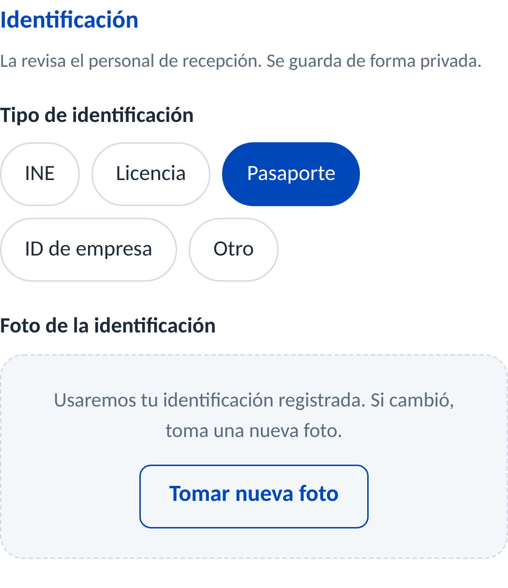

La foto se guarda **de forma privada**: solo el personal de recepción la ve, con enlaces que caducan en 5 minutos.

## C.4 Horario de la visita

Elige **fecha y hora de entrada** y **fecha y hora de salida** (hora del centro de México). La salida debe ser después de la entrada; una visita puede durar hasta 7 días.

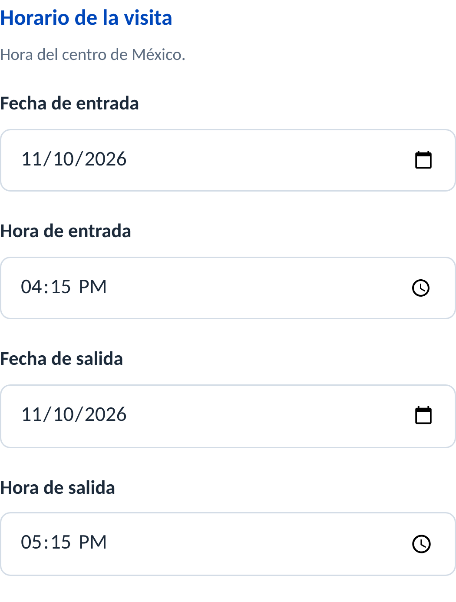

> **Importante:** el día de tu visita podrás entrar desde **10 minutos antes** de tu hora de entrada y hasta la **tolerancia** configurada (normalmente 15 minutos después). Elige la hora a la que de verdad llegarás.

## C.5 Tu visita

- **¿A quién visitas?** Elige a la persona de la lista. Si no aparece, elige **Otra persona o área** y escribe el nombre.
- **Motivo**: Reunión, Entrevista, Proveedor o servicio, Entrega o paquetería, u Otro.
- **Accederé a salas de juntas**: si lo marcas, toca **Tomar selfie** (se abre la cámara frontal).
- **Comentarios** (opcional).

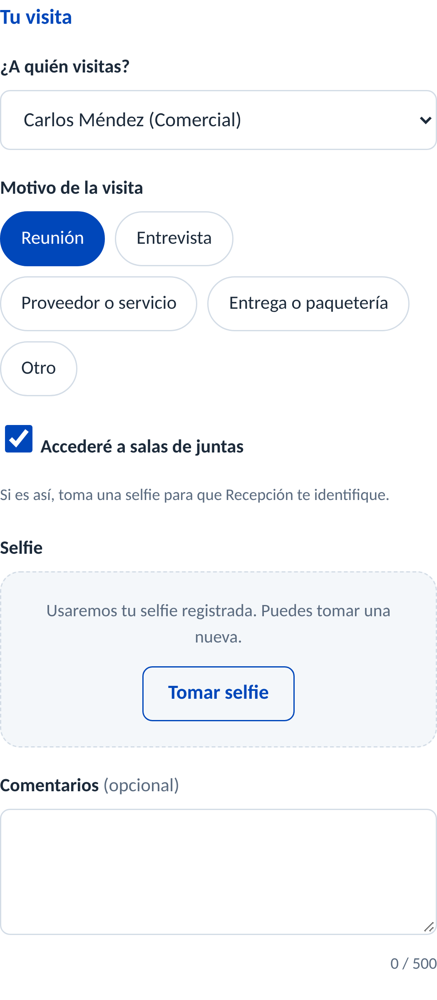

## C.6 Equipo de cómputo (opcional)

Si ingresas una laptop, tablet, proyector u otro equipo, elige el tipo y escribe marca y número de serie. Agiliza tu salida.

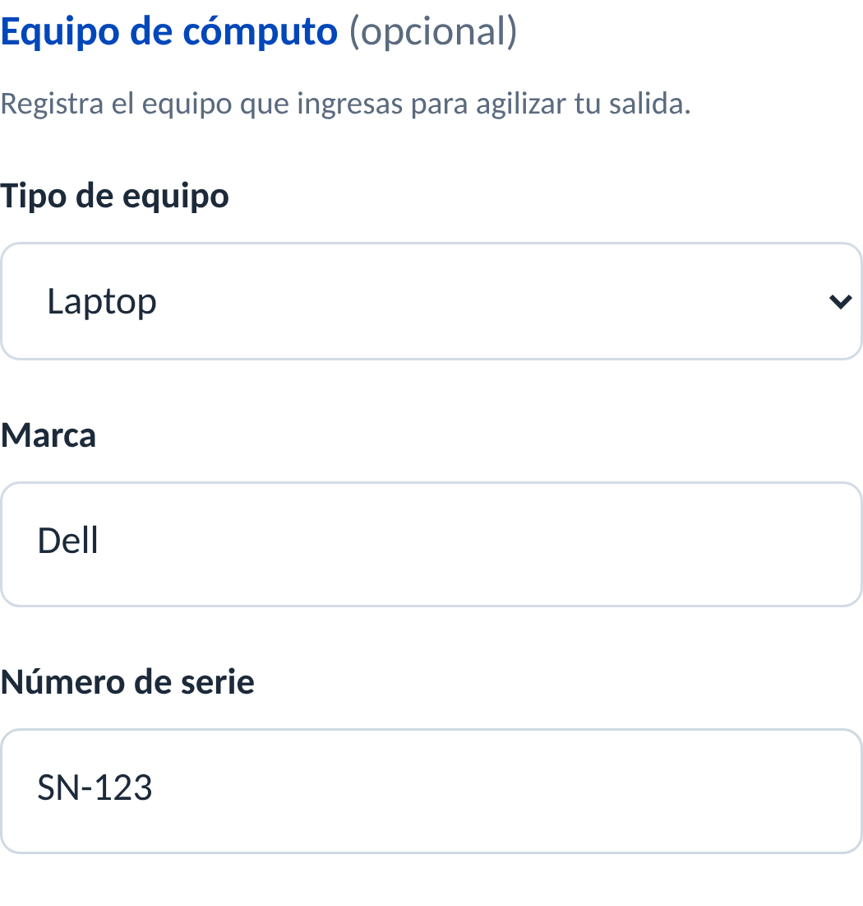

## C.7 Guarda tus datos y acepta el aviso

- Marca **Guardar mis datos para mis próximas visitas** si nos visitarás de nuevo.
- Lee y acepta el **aviso de privacidad** de HIXSA.
- Toca **Registrar mi visita**.

---

# Parte D. Después del registro

## D.1 Tu pase con código QR

Verás tu **folio** y tu **código QR**. Toca **Descargar pase** para guardarlo en tu celular. También lo recibes por correo, con:

- La imagen del QR.
- La invitación **“Agregar a Google Calendar”** y un archivo `invitacion.ics` para otros calendarios.

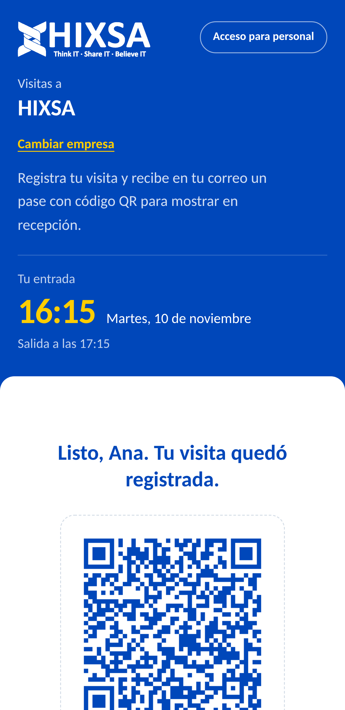

## D.2 Aprobación de tu anfitrión

Tu anfitrión recibe un correo para **aprobar o rechazar** la visita. Te avisaremos por correo:

- **Visita confirmada:** muestra tu QR al llegar.
- **Visita no autorizada:** comunícate con la persona que ibas a visitar.

Si elegiste *Otra persona o área*, **Recepción valida tu visita** al llegar.

## D.3 Al llegar a recepción

1. Muestra tu **QR** (en el celular o impreso).
2. Recepción lo escanea, revisa tu identificación y registra tu **entrada**.
3. Al salir, Recepción registra tu **salida** (a cualquier hora).

**Si llegas fuera de tu horario** verás que Recepción no puede registrar tu entrada (*ACCESO NO PERMITIDO*):

| Situación | Qué pasa |
|---|---|
| Llegas más de 10 minutos antes | Espera a tu hora, o Recepción puede autorizarte con un motivo. |
| Llegas después de la tolerancia | Recepción puede autorizarte con un motivo (por ejemplo, confirmándolo con tu anfitrión). |
| Llegas en **otro día** | Debes hacer un **nuevo registro** con la fecha correcta. |
| Tu pase ya venció | Debes hacer un **nuevo registro**. |

## Preguntas frecuentes

| Pregunta | Respuesta |
|---|---|
| No me llegó el correo | Revisa *spam*. Tu pase también se puede descargar al terminar el registro y Recepción puede reenviártelo. |
| Me equivoqué de fecha u hora | Haz un nuevo registro con los datos correctos. |
| ¿Quién ve mi identificación y mi selfie? | Solo el personal autorizado de HIXSA, en un almacenamiento privado. Nunca se envían por correo. |
| No recibí el código de recurrente | Espera unos minutos y usa **Enviarme otro código** (máximo 3 cada 15 minutos). Si nunca guardaste tus datos, llena el formulario normal. |
| ¿Puede Recepción invitarme sin llenar el formulario? | Sí. Si ya nos visitaste, el personal puede enviarte una **nueva invitación** con tus datos guardados; recibirás el QR en tu correo. |
| Quiero que borren mis datos | Solicítalo conforme al aviso de privacidad de HIXSA. |
